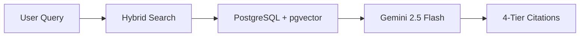

# BIS Intelligent Assistant — Documentation Portal 📚
### *Authoritative Technical Documentation & Engineering Specifications*
**Smart India Hackathon (SIH) Problem Statement 26107**: *"AI-powered Intelligent Assistant for Indian Standards and BIS Services for Industries and Consumers"*

[](https://docusaurus.io)
[](https://www.typescriptlang.org)
[](https://react.dev)
[](https://mdxjs.com)
[-blueviolet.svg)](#-offline-local-search-ctrl--k)
[](https://mermaid.js.org)

---

## 📌 Overview

This repository houses the complete, production-grade technical documentation portal for the **BIS Intelligent Assistant**.

Built from the ground up using **Docusaurus 3.7**, **TypeScript**, and **MDX**, this documentation serves as the single source of truth for:
- System architects, ML engineers, backend/frontend developers, and regulatory auditors.
- Compliance officers and MSME manufacturers seeking deep technical understanding of how the assistant maps natural-language queries to official Bureau of Indian Standards (BIS) documents, Quality Control Orders (QCOs), and testing laboratories.
- Evaluation metrics, live tested benchmarks, security threat models, and prompt-injection defense mechanisms.

---

## 🌟 Key Architectural Features

| Feature | Description |
|---|---|
| **85+ Technical `.mdx` Specs** | Deep, non-placeholder architectural guides, SQL schemas, API definitions, data pipeline specifications, and ML workflows. |
| **Offline Local Search (`Ctrl + K`)** | Full-text client-side search powered by `@easyops-cn/docusaurus-search-local` with zero external cloud dependencies—fully functional in air-gapped government environments. |
| **Multi-Section Navigation** | Dedicated top-level navigation tabs for **Core Docs**, **ML Docs**, **RAG Docs**, and **Research / Blog**. |
| **Consolidated Navigation** | Clean sidebar with single-document views for **System Architecture** (`03. System Architecture`) and **Database & Data Pipeline** (`05. Database & Data Pipeline`), eliminating unnecessary nested accordions. |
| **Interactive Visualizations** | Rendered Mermaid diagrams for data flows, multi-agent topologies, database ERDs, and RAG retrieval pipelines. |
| **Responsive Dark & Light Themes** | Native theme toggling with accessible contrast ratios aligned with modern design standards. |
| **Strict Document Link Validation** | Docusaurus build pipeline verifies internal cross-references to guarantee zero broken links. |

---

## 🧭 Information Architecture

The documentation is organized into four main areas accessible from the navigation header:

```mermaid
flowchart TD
    Nav[Docusaurus Top Navigation Bar]
    Nav --> Core[📘 Core Docs]
    Nav --> ML[🤖 ML Docs]
    Nav --> RAG[🔍 RAG Docs]
    Nav --> Blog[🔬 Research / Blog]

    subgraph CoreDocs [Core Technical Modules]
        Core --> Intro[01. Introduction]
        Core --> Req[02. Requirements]
        Core --> Arch[03. System Architecture]
        Core --> BIS[04. BIS Standards & Compliance]
        Core --> DBPipeline[05. Database & Data Pipeline]
        Core --> Backend[06. Backend & REST APIs]
        Core --> Frontend[07. Frontend Application]
        Core --> Sec[08. Security & Guardrails]
        Core --> Test[09. Testing & Quality]
        Core --> Dev[10. Development Guide]
        Core --> Deploy[11. Deployment & DevOps]
    end

    subgraph MLDocs [Machine Learning & Agents]
        ML --> MultiAgent[Multi-Agent System]
        ML --> IntentAgent[Query & Intent Classifier]
        ML --> ProductAgent[Product Disambiguation]
        ML --> MandAgent[Mandatory Status Agent]
        ML --> LabAgent[Testing & Lab Search]
        ML --> MLEval[Evaluation Benchmarks]
    end

    subgraph RAGDocs [Retrieval Engine]
        RAG --> RAGArch[RAG Architecture]
        RAG --> Chunk[Clause-Aware Chunking]
        RAG --> Embed[Embeddings & Vector Store]
        RAG --> Hybrid[Hybrid Dense-Sparse Retrieval]
        RAG --> Rerank[Cross-Encoder Reranker]
        RAG --> Citations[4-Tier Citation Engine]
    end

    subgraph BlogDocs [Research & Publications]
        Blog --> BenchReport[Live Benchmark Evaluation Report: 100% Pass Rate]
    end
```



---

## 📂 Documentation Directory Structure

```
bis-docs/
├── docs/
│   ├── 01-introduction/               # Project background, objectives, scope & use cases
│   │   ├── overview.mdx
│   │   ├── problem-statement.mdx
│   │   ├── objectives.mdx
│   │   ├── scope.mdx
│   │   ├── target-users.mdx
│   │   └── use-cases.mdx
│   │
│   ├── 02-requirements/               # SRS specifications & system constraints
│   │   ├── functional-requirements.mdx
│   │   ├── non-functional-requirements.mdx
│   │   ├── system-requirements.mdx
│   │   └── constraints.mdx
│   │
│   ├── 03-solution/                   # Proposed solution, innovation & societal impact
│   │   ├── proposed-solution.mdx
│   │   ├── solution-overview.mdx
│   │   ├── innovation.mdx
│   │   ├── benefits.mdx
│   │   └── impact.mdx
│   │
│   ├── 04-architecture/               # Consolidated master system architecture
│   │   └── system-architecture.mdx    # Merged system architecture, data flow & security
│   │
│   ├── 05-bis-knowledge/              # BIS regulatory domain knowledge
│   │   ├── bis-overview.mdx
│   │   ├── standards.mdx
│   │   ├── qco.mdx
│   │   ├── amendments.mdx
│   │   ├── certification.mdx
│   │   ├── testing.mdx
│   │   └── laboratories.mdx
│   │
│   ├── 07-ai-agent/                   # Multi-agent orchestrator & Gemini integration
│   │   ├── agent-overview.mdx
│   │   ├── gemini-agent.mdx
│   │   ├── intent-detection.mdx
│   │   ├── tool-selection.mdx
│   │   ├── context-management.mdx
│   │   └── fallback-handling.mdx
│   │
│   ├── 08-compliance/                 # Regulatory compliance & verification logic
│   │   ├── compliance-overview.mdx
│   │   ├── standard-applicability.mdx
│   │   ├── mandatory-certification.mdx
│   │   ├── qco-validation.mdx
│   │   ├── testing-requirements.mdx
│   │   └── evidence-validation.mdx
│   │
│   ├── 09-database/                   # Consolidated DB & ingestion pipeline
│   │   └── database-data-pipeline.mdx # Merged PostgreSQL, pgvector, ORM, Scraping & PDF Chunking
│   │
│   ├── 10-backend/                    # FastAPI backend design & services
│   │   ├── backend-overview.mdx
│   │   ├── fastapi.mdx
│   │   ├── project-structure.mdx
│   │   ├── services.mdx
│   │   ├── sqlalchemy.mdx
│   │   ├── authentication.mdx
│   │   └── error-handling.mdx
│   │
│   ├── 11-api/                        # OpenAPI REST endpoints
│   │   ├── api-overview.mdx
│   │   ├── standards.mdx
│   │   ├── laboratories.mdx
│   │   ├── search.mdx
│   │   └── chat.mdx
│   │
│   ├── 12-frontend/                   # React 18 frontend architecture
│   │   ├── frontend-overview.mdx
│   │   ├── project-structure.mdx
│   │   ├── search-interface.mdx
│   │   ├── chat-interface.mdx
│   │   └── citations.mdx
│   │
│   ├── 13-security/                   # Security, threat model & prompt defense
│   │   ├── security-overview.mdx
│   │   ├── authentication.mdx
│   │   ├── authorization.mdx
│   │   ├── api-security.mdx
│   │   └── prompt-injection.mdx
│   │
│   ├── 14-testing/                    # Testing methodology & scenario evaluation
│   │   ├── testing-overview.mdx
│   │   ├── unit-testing.mdx
│   │   ├── api-testing.mdx
│   │   ├── scenario-testing.mdx
│   │   └── evaluation-results.mdx
│   │
│   ├── 15-development/                # Developer guides & contribution standards
│   │   ├── local-setup.mdx
│   │   ├── project-structure.mdx
│   │   ├── coding-guidelines.mdx
│   │   ├── git-workflow.mdx
│   │   └── troubleshooting.mdx
│   │
│   ├── 16-deployment/                 # Cloud infrastructure & deployment
│   │   ├── deployment-overview.mdx
│   │   ├── environment-variables.mdx
│   │   ├── docker.mdx
│   │   ├── ci-cd.mdx
│   │   ├── monitoring.mdx
│   │   └── production.mdx
│   │
│   ├── ml/                            # Machine Learning & Multi-Agent subsystem
│   │   ├── multi-agent-system.mdx
│   │   ├── query-agent-intent.mdx
│   │   ├── product-disambiguation-agent.mdx
│   │   ├── mandatory-status-agent.mdx
│   │   ├── testing-lab-agents.mdx
│   │   └── evaluation-benchmarks.mdx
│   │
│   └── rag/                           # Retrieval-Augmented Generation subsystem
│       ├── architecture.mdx
│       ├── clause-chunking.mdx
│       ├── embeddings-vector-store.mdx
│       ├── hybrid-retrieval.mdx
│       ├── reranking-engine.mdx
│       └── citation-engine.mdx
│
├── blog/                              # Research blog & benchmark releases
│   └── research/
│       └── 2026-09-26-live-benchmark-results.mdx
│
├── src/                               # Custom React pages & styling
│   ├── components/                    # Custom MDX components & landing page blocks
│   ├── css/custom.css                 # Custom CSS variables, dark mode styling & typography
│   └── pages/index.tsx                # Hero landing page with action cards
│
├── docusaurus.config.ts               # Primary Docusaurus configuration
├── sidebars.ts                        # Master sidebar hierarchy definition
├── package.json                       # Dependencies & script definitions
└── tsconfig.json                      # TypeScript configuration
```

---

## ⚡ Quick Start & Development

### 1. Prerequisites
- **Node.js**: Version `18.0.0` or higher (verified on Node.js v20 / v22)
- **Package Manager**: `npm` (default), `yarn`, or `pnpm`

### 2. Installation
Install project dependencies including `@easyops-cn/docusaurus-search-local`:
```bash
npm install
```

### 3. Local Development Server
Start the development server with hot-module reloading:
```bash
npm run start
```
The documentation portal will open at **`http://localhost:3000`**. Edits in any `.mdx` file will reflect automatically in the browser.

### 4. Production Static Build
Compile the site for production. Docusaurus validates all MDX syntax, links, and builds offline search indexes:
```bash
npm run build
```
Compiled static assets will be output to the `build/` directory.

### 5. Preview Production Build Locally
Verify the generated build locally with an HTTP server:
```bash
npm run serve
```
Preview will be accessible at **`http://localhost:3000`**.

### 6. Type Checking
Run TypeScript type validation across all components and configuration files:
```bash
npm run typecheck
```

### 7. Clear Cache
If you encounter caching anomalies after large restructuring:
```bash
npm run clear
```

---

## 🔍 Offline Local Search (`Ctrl + K`)

The portal integrates `@easyops-cn/docusaurus-search-local` directly into the navigation bar:
- **Index Generation**: Built automatically during `npm run build` from all `.mdx` pages, headings, and blog entries.
- **Search Keybinding**: Press <kbd>Ctrl</kbd> + <kbd>K</kbd> (or <kbd>Cmd</kbd> + <kbd>K</kbd> on macOS) anywhere on the site to trigger the instant search modal.
- **Privacy & Air-Gap Compliance**: No queries are transmitted to third-party services like Algolia or Google. The index runs 100% in client-side WebAssembly/JavaScript.

---

## ✍️ Contribution & MDX Authoring Guide

All documentation files **must strictly use the `.mdx` extension**.

### Standard Page Frontmatter
Every `.mdx` file must start with standardized YAML frontmatter:
```mdx
---
id: system-architecture
title: System Architecture & Data Flow
sidebar_label: 03. System Architecture
description: Comprehensive technical architecture of the BIS Intelligent Assistant.
keywords: [architecture, multi-agent, rag, data-flow, gemini]
---
```

### Interactive Admonitions (Callouts)
Use GitHub-style alert callouts to highlight important operational considerations:
```markdown
> [!NOTE]
> Indian Standards are maintained in bilingual Hindi and English editions.

> [!IMPORTANT]
> The mandatory status of a standard requires an active Gazette QCO notification.

> [!WARNING]
> Expired or superseded standard versions must never be cited as current compliance.
```

### Fenced Mermaid Diagrams
Add architecture and workflow diagrams natively using standard `mermaid` code blocks:
````markdown

````

---

## 👥 Authors & Acknowledgements

Developed as part of the **Smart India Hackathon (SIH)** project under **Problem Statement 26107** for the **Bureau of Indian Standards (BIS)**, Ministry of Consumer Affairs, Food & Public Distribution, Government of India.

