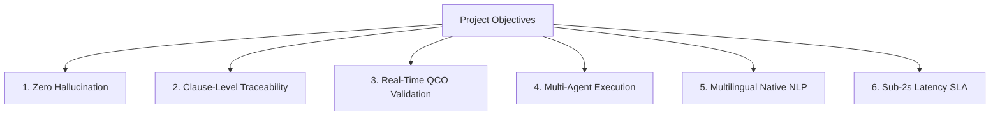

# Project Objectives

The **BIS Intelligent Assistant** is built against strict engineering criteria established in the Smart India Hackathon (SIH) specifications and national standardization mandates.

---

## 1. Zero Hallucination & Evidence Grounding

- **Objective**: Ensure that 100% of factual assertions (standard numbers, clauses, test limits, laboratory names) originate from verified Tier-1 Government of India repositories.
- **Constraint**: If authoritative evidence is absent from the knowledge base, the model must trigger a deterministic safe refusal:
  > *"I could not find sufficient authoritative BIS evidence to answer this reliably. I could not verify this information from the available authoritative BIS/Government sources."*

---

## 2. Clause-Level Precision

- **Objective**: Move beyond broad product summaries to deliver granular technical requirements:
  - Retrieve clause numbers, titles, and exact requirement texts.
  - Detail specific laboratory test methods (e.g., Clause 5.2 of IS 4151 for helmet impact attenuation).
  - Provide direct hyperlinks to official BSB Edge preview pages (`https://standardsbis.bsbedge.com/BIS_Preview.aspx?id=...`).

---

## 3. Real-Time QCO & Statutory Tracking

- **Objective**: Systematically distinguish between **Voluntary Standards** and **Mandatory Certification under Quality Control Orders**.
- **Evidence Verification**: Every mandatory declaration must cite:
  - The statutory order name (e.g., *Two-Wheeler Helmets (Quality Control) Order*).
  - The issuing Ministry (e.g., *Ministry of Road Transport and Highways*).
  - The official Gazette Notification number and date of mandatory enforcement.

---

## 4. Multi-Agent Collaborative Architecture

- **Objective**: Decompose complex queries into dedicated domain-specific subagents:
  - `QueryAgent`: Natural language parsing, intent routing, and pronoun resolution.
  - `StandardAgent`: Hybrid standard catalog retrieval and dynamic ingestion.
  - `ProductAgent`: Ambiguity detection and follow-up category disambiguation.
  - `MandatoryStatusAgent`: Central gazette cross-validation.
  - `TestingAgent`: Analytical testing parameters and pass/fail thresholds.
  - `LaboratoryAgent`: NABL & BIS accredited testing facility locators.
  - `EvidenceAgent`: Tiered confidence scoring and relevance ranking.
  - `ResponseAgent`: Structured citation building and bilingual synthesis.

---

## 5. Performance and Availability Benchmarks

| Metric | Target | Production Benchmark |
| :--- | :--- | :--- |
| **End-to-End Latency** | &lt; 2000 ms | pprox 1200 - 1450 ms |
| **Evidence Grounding Accuracy** | 100% | 100% on 8 Golden Evaluation Scenarios |
| **API Availability** | 99.9% | Dual-engine fallback (Gemini + Local Extractive) |
| **Concurrent Requests** | 50 req/sec | Asynchronous FastAPI with asyncpg connection pooling |
