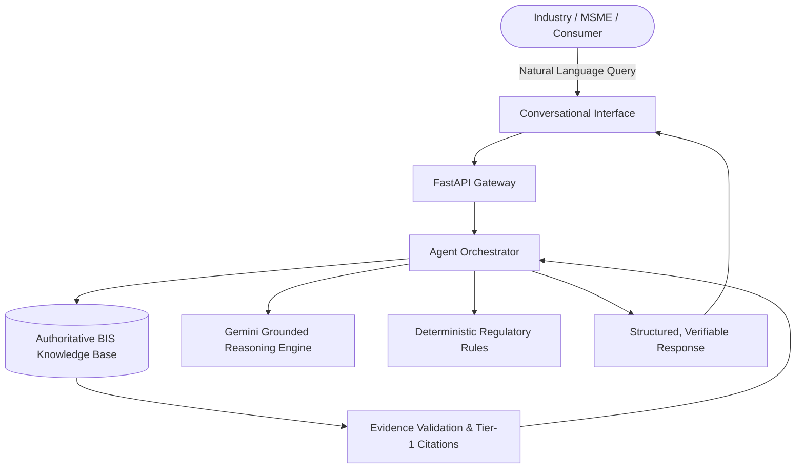

# BIS Intelligent Assistant — System Overview

The **BIS vijay test Intelligent Assistant** is an authoritative, enterprise-grade AI conversational platform engineered specifically for the **Bureau of Indian Standards (BIS)** ecosystem and the **Ministry of Consumer Affairs, Food & Public Distribution**, Government of India. 

Operating at the intersection of regulatory compliance, standardization engineering, and advanced agentic AI, the system democratizes access to over **20,000+ Indian Standards (IS)**, hundreds of **Quality Control Orders (QCOs)**, laboratory accreditations, and conformity assessment schemes.

---

## Strategic Mission

The Bureau of Indian Standards plays a pivotal role in India's national quality infrastructure. However, the volume, complexity, and distributed nature of standards documentation make discovery and compliance verification challenging for small and medium enterprises.

The mission of the BIS Intelligent Assistant is threefold:

1. **Eliminate Information Asymmetry**: Provide instantaneous, clause-level clarity on technical requirements to manufacturers, testing laboratories, and startups across India.
2. **Guarantee Absolute Source Grounding**: Enforce a strict **zero-hallucination policy** where all statements must trace back to official Gazette notifications, published Indian Standards, or BIS portal databases.
3. **Accelerate National Quality Adoption**: Facilitate compliance with Quality Control Orders (QCOs), supporting the *Make in India* and *Atmanirbhar Bharat* initiatives by ensuring domestic products meet global safety and performance benchmarks.

---

## Core Capabilities Matrix

| Functional Capability | Description | Primary Users |
| :--- | :--- | :--- |
| **Standard Discovery** | Identifies applicable Indian Standards from informal product descriptions and technical keywords. | MSMEs, Startups, Product Designers |
| **Clause-Level Extraction** | Retrieves exact clause texts, testing conditions, tolerances, and design equations. | Testing Engineers, Quality Auditors |
| **Mandatory QCO Check** | Verifies legal certification status under Central Government Gazette notifications. | Legal Counsel, Compliance Officers |
| **Laboratory Locator** | Maps standards to authorized BIS Central, Regional, and NABL-accredited testing facilities. | Manufacturers, Supply Chain Leads |
| **Consumer Safeguard** | Guides consumers on ISI mark verification, HUID gold hallmarking, and grievance redressal via BIS Care. | General Consumers, Retailers |
| **Multilingual Support** | End-to-end conversational processing in English, Hindi, and regional languages. | Rural Artisans, Regional Enterprises |

---

## Technical Division Coverage

The knowledge pipeline ingests and tracks standards across all 15 technical divisions of the Bureau of Indian Standards:

- **CHD**: Chemical Department (Paints, Fertilizers, Polymers, Inks)
- **CED**: Civil Engineering Department (Cement, Concrete, Structural Steels, Building Codes)
- **ETD**: Electrotechnical Department (Switchgear, Transformers, Cables, EV Chargers)
- **LITD**: Electronics and Information Technology (Consumer Electronics, IT Equipment, Smart Cards)
- **MED / MTD**: Mechanical Engineering & Metallurgical Department (Pressure Vessels, TMT Rebars, Structural Steel)
- **FAD**: Food and Agriculture Department (Food Safety, Infant Milk, Packaged Drinking Water)
- **TXD**: Textile Department (Protective Gear, Geotextiles, Industrial Fabrics)

---

## Architectural Distinctions

Unlike generic chatbots or unconstrained LLMs that frequently fabricate standard numbers and regulatory requirements:

- **Strict Tier-1 Authority**: Information is sourced exclusively from official domains (`bis.gov.in`, `standards.bis.gov.in`, `manakonline.in`, `egazette.gov.in`).
- **Deterministic Regulatory Guardrails**: QCO mandates and legal enforcement dates are managed through deterministic relational validation rather than probabilistic guessing.
- **Fail-Safe Safe Refusal**: If authoritative evidence is missing, the system outputs a standardized refusal rather than hallucinating compliance specifications.
