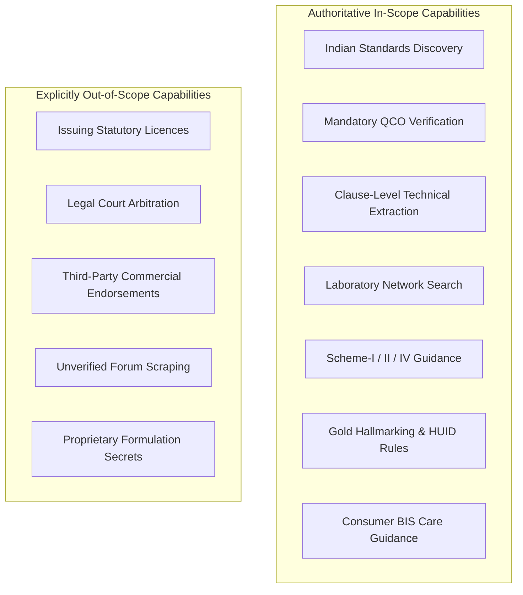

# Scope of the Platform

To maintain strict regulatory integrity and prevent legal liability, the platform defines rigid operational boundaries.

---

## In-Scope Functional Capabilities

### 1. Indian Standards Discovery & Technical Exploration
- Mapping colloquial or industrial product descriptions (e.g., "saria", "geyser", "petrol marking paint") to formal IS standards (`IS 1786`, `IS 302-2-21`, `IS 138`).
- Explaining the technical scope, committee jurisdiction, and current publication status (Active, Reaffirmed, Revised, Withdrawn).

### 2. Regulatory Status & QCO Orders
- Determining whether a product requires mandatory ISI marking under central ministerial orders.
- Reporting effective dates, small-scale enterprise enforcement dates, and export exemption clauses.

### 3. Testing Methods & Quality Protocols
- Listing standard-mandated physical, chemical, electrical, and mechanical tests.
- Highlighting sample lot sizes, acceptance criteria, and permissible tolerances.

### 4. Laboratory Discovery
- Searching BIS recognized and NABL accredited laboratories by standard number and geographic location (State / City).

### 5. Consumer & Hallmarking Assistance
- Explaining the mandatory 3-mark gold hallmarking framework (BIS Mark, Karat/Purity, 6-digit alphanumeric HUID).
- Providing instructions for lodging consumer complaints on the official BIS Care mobile application.

---

## Out-of-Scope Boundaries

| Out-of-Scope Item | Rationale & Alternative Action |
| :--- | :--- |
| **Direct Licence Issuance** | The assistant is an informational tool. Manufacturers must formally submit grant-of-licence applications via [Manakonline](https://www.manakonline.in). |
| **Legal Interpretation** | The assistant provides statutory excerpts but does not render legal counsel in commercial disputes or court proceedings. |
| **Commercial Testing Bidding** | The assistant displays authorized public and accredited labs without favoring private testing providers. |
| **ISO/Foreign Standards Negotiation** | The scope focuses on national Indian Standards (IS). International ISO/IEC standards are referenced only where adopted as dual-number standards. |
