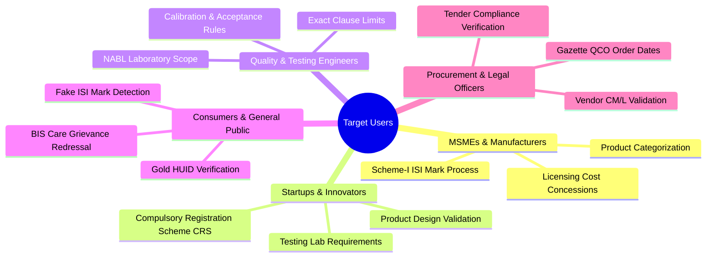

# Target Users & Personas

The platform serves five core stakeholder groups, each with distinct technical vocabularies and regulatory requirements.

---

## 1. Indian MSMEs & Domestic Manufacturers

- **Profile**: Managing partners or plant heads in small-to-medium manufacturing units (plastics, electrical switches, structural steel fabrication).
- **Core Need**: Rapidly determine if their product falls under a new Quality Control Order, find the applicable standard, and understand licensing steps under Scheme-I.
- **Pain Point**: Cannot afford expensive regulatory legal consultants; struggle with dense English gazette notifications.
- **Platform Value**: Multilingual (Hindi/Marathi) interaction, step-by-step licensing outlines, and automated category disambiguation.

---

## 2. Startups & Hardware Innovators

- **Profile**: Technology founders and embedded hardware developers launching IoT devices, smart chargers, or drones.
- **Core Need**: Identify applicability under the **Compulsory Registration Scheme (CRS)** (Scheme-II), find safety testing protocols (e.g., `IS 13252 (Part 1)` for power adapters or `IS 16046` for lithium batteries).
- **Pain Point**: Confusing self-declaration protocols and rapid market-entry timelines.
- **Platform Value**: Immediate clarity on CRS vs ISI mark, testing schedules, and accredited IT testing laboratories.

---

## 3. Laboratory Analysts & Quality Control Managers

- **Profile**: NABL-accredited laboratory technicians, chief chemists, and quality assurance leads.
- **Core Need**: Precise verification of clause-level test criteria, sample conditioning parameters, and normative reference standards.
- **Pain Point**: Searching through 60-page PDF standards to locate specific tables and tolerances.
- **Platform Value**: Instant extraction of clause numbers, test summaries, and official BSB Edge preview hyperlinks.

---

## 4. Institutional Procurement Officers & Tender Committees

- **Profile**: Public sector undertakings (PSUs), Indian Railways, and CPWD engineers drafting public procurement tenders.
- **Core Need**: Confirm that tender specifications mandate valid, reaffirmed Indian Standards and that bidding vendors hold valid CM/L licenses.
- **Pain Point**: Dealing with vendors quoting superseded or cancelled standards.
- **Platform Value**: Real-time status checks (Active vs Reaffirmed vs Withdrawn) and gazette verification.

---

## 5. Indian Consumers & Citizens

- **Profile**: Everyday consumers purchasing household appliances, packaged water, or gold jewelry.
- **Core Need**: Verify the authenticity of an ISI mark, check a 6-digit HUID code on gold jewelry, or understand how to report a defective product.
- **Pain Point**: Proliferation of counterfeit ISI marks on substandard helmets, pressure cookers, and toys.
- **Platform Value**: Consumer protection education, BIS Care App instructions, and clear guidance on statutory hallmarks.
