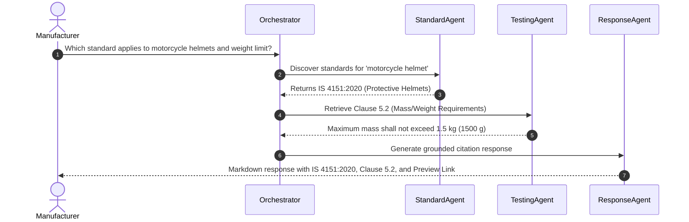
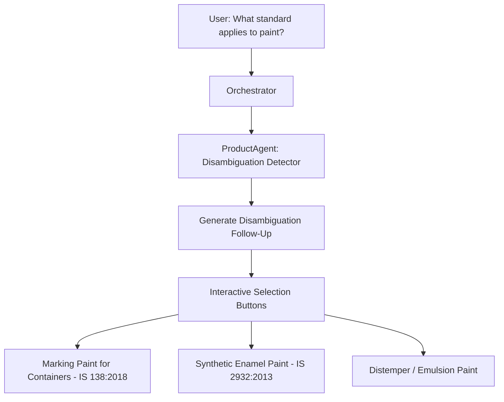

# Real-World Use Cases

The following real-world workflows illustrate how the BIS Intelligent Assistant operates across diverse regulatory situations.

---

## Use Case 1: Standard Discovery for Two-Wheeler Helmets

### User Query
> *"Which standard applies to motorcycle helmets, and what is the maximum weight allowed?"*

### System Response Highlights
- **Identified Standard**: `IS 4151:2020` (*Protective Helmets for Two-Wheeler Riders*).
- **Clause Extraction**: **Clause 5.2** restricts the total mass of the helmet to **1.5 kg (1500 grams)** to avoid rotational neck injury.
- **Citations**: Sourced from official BIS standard copy with preview URL `https://standardsbis.bsbedge.com/BIS_Preview.aspx?id=IS_4151_2020`.

---

## Use Case 2: Mandatory QCO Verification for Structural Steel

### User Query
> *"Is BIS certification mandatory for manufacturing TMT steel rebars in India?"*

### Execution Path
1. **Query Parsing**: Identified product `tmt steel bars` and intent `MANDATORY_STATUS`.
2. **Standard Resolution**: Matches `IS 1786:2008` (*High strength deformed steel bars and wires for concrete reinforcement*).
3. **Regulatory Verification**: Cross-references Ministry of Steel Quality Control Orders.
4. **Outcome**:
   - **Status**: **MANDATORY**.
   - **Statutory Order**: *Steel and Steel Products (Quality Control) Order*.
   - **Enforcement**: Manufacturing, importing, or selling without an active BIS CM/L license is strictly illegal under Section 29 of the BIS Act, 2016.

---

## Use Case 3: Category Disambiguation for Ambiguous Product Inquiries

### User Query
> *"What standard applies to paint?"*

### Problem
"Paint" is a broad category encompassing industrial marking paint (`IS 138`), synthetic enamel paint (`IS 2932`), plastic emulsion paint (`IS 5411`), and anti-corrosive primer (`IS 2074`).

### System Response Highlights
The assistant resolves the primary candidate (`IS 138:2018` for Marking Paint) while simultaneously rendering an **Agent Follow-Up Question**:
> *"Which type or application of paint do you produce or wish to certify?"*
- **Option A**: *Marking Paint for Packages & Petrol Containers (IS 138:2018)*
- **Option B**: *Synthetic Enamel Paint (IS 2932:2013)*
- **Option C**: *Weather-proof Exterior Emulsion*

---

## Use Case 4: Multilingual Consumer Inquiry in Hindi

### User Query
> *"सोने के आभूषण खरीदते समय मुझे कौन से हॉलमार्क निशान देखने चाहिए?"*

### System Response (Hindi)
- **मानक**: `IS 15820:2009` एवं बीआईएस हॉलमार्किंग विनियम।
- **3 अनिवार्य पहचान चिह्न**:
  1. **बीआईएस मानक लोगो** (त्रिभुजाकार BIS Mark)।
  2. **शुद्धता और सुंदरता (Purity/Fineness)**: जैसे 22K916 (91.6% शुद्ध सोना), 18K750 (75.0% सोना)।
  3. **6-अंकों का अल्फ़ान्यूमेरिक HUID कोड** (Hallmark Unique Identification Number)।
- **उपभोक्ता सुरक्षा**: बीआईएस केयर ऐप (`BIS Care App`) पर "Verify HUID" सुविधा से आभूषण की प्रामाणिकता तुरंत जांचें।
