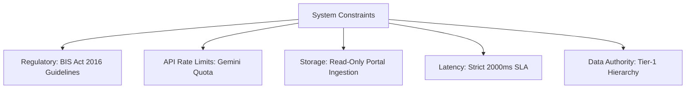

# Constraints & Boundary Conditions

To maintain compliance with Government of India regulations and technical service limitations, the platform operates under several hard constraints.

---

## 1. Regulatory & Statutory Constraints

### BIS Act, 2016 Adherence
The platform must strictly respect the statutory language of the Bureau of Indian Standards Act, 2016:
- The assistant cannot declare a product "approved" or "certified" on its own authority; it can only state whether an Indian Standard exists and whether a Quality Control Order mandates certification.
- All references to certification schemes must explicitly distinguish between **Scheme-I (ISI Product Certification)**, **Scheme-II (CRS)**, and **Scheme-IV (Certificate of Conformity)**.

### Tier-1 Source Exclusivity
The system is explicitly forbidden from citing or indexing:
- Commercial compliance blogs.
- Wikipedia or crowdsourced wikis.
- Social forums (Reddit, Quora).
- Private testing lab marketing brochures.

---

## 2. API Quotas & External Dependency Constraints

### Gemini API Rate Limits
- The Google Gemini API free-tier enforces a rate limit of **20 requests per day** on `gemini-3.6-flash` and strict RPM caps on `gemini-1.5-flash`.
- **Constraint Resolution**: The system must decouple retrieval from generation. When LLM rate limits (HTTP 429) are encountered, the orchestrator triggers the **extractive reasoning engine**, assembling validated Section-12 standard profiles directly from database chunks with zero disruption to the user.

---

## 3. Data Integrity & PDF Ingestion Limits

### Watermarked Standard Previews
- Full Indian Standard copies are subject to copyright held by the Bureau of Indian Standards. Standard copies available on `standardsbis.bsbedge.com` are protected watermarked previews.
- **Constraint Resolution**: The system ingests public scopes, clause numbers, headings, normative references, and test method definitions, while providing users with direct hyperlinks to official BSB Edge preview pages rather than redistributing full copyrighted standard PDFs.
