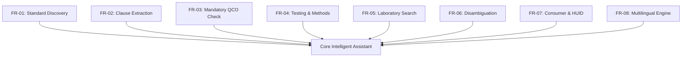

# Functional Requirements Specification

The system's functional capabilities are organized into formal functional requirements (FR), aligned with the Bureau of Indian Standards product certification lifecycle.

---

## FR-01: Natural Language Standard Discovery

- **FR-01.1**: The system shall accept natural language descriptions of products (e.g., "potable tap water", "electric geyser", "cricket helmet") and resolve them to official Indian Standard numbers.
- **FR-01.2**: The system shall support direct alphanumeric IS number searches (e.g., `IS 456`, `IS 1786:2008`, `IS 13252 (Part 1)`).
- **FR-01.3**: The system shall dynamically resolve and ingest valid un-seeded numeric Indian Standards using the `DynamicBISPipeline`.
- **FR-01.4**: For each identified standard, the system shall provide:
  - Standard number and full official title.
  - Revision/Edition number and publication year.
  - Reaffirmation date and active status.
  - Direct hyperlink to the official BSB Edge preview portal.

---

## FR-02: Granular Clause-Level Technical Retrieval

- **FR-02.1**: The system shall parse explicit clause inquiries (e.g., *"What does Clause 5.2 of IS 4151 state?"*).
- **FR-02.2**: The system shall extract and display:
  - Clause number and clause heading.
  - Verbatim technical specification text.
  - Applicable tables, formulas, and performance limits.
  - Page number reference within the official document.
- **FR-02.3**: If a requested clause is missing from the document, the system shall return an explicit refusal statement rather than guessing the clause content.

---

## FR-03: Quality Control Order (QCO) Verification

- **FR-03.1**: The system shall cross-reference candidate standards against central government gazette orders to declare certification status:
  - `MANDATORY`: Covered under an active statutory QCO.
  - `VOLUNTARY`: Standard exists under Scheme-I but certification is not legally compulsory.
- **FR-03.2**: For all mandatory products, the response shall provide:
  - Quality Control Order full title.
  - Issuing Ministry / Department.
  - Gazette notification number (S.O. number) and date of notification.
  - Effective enforcement date and any special enforcement dates for micro/small enterprises.
  - Statutory exemption conditions (e.g., export-bound production).

---

## FR-04: Testing Requirements & Methodologies

- **FR-04.1**: When queried regarding product testing, the system shall identify all statutory tests required for conformity assessment.
- **FR-04.2**: Test descriptions shall specify the standard test method, required apparatus, and quantitative acceptance thresholds.
- **FR-04.3**: The system shall not infer tests from general industry practice unless supported by the retrieved standard text.

---

## FR-05: Laboratory Search & Discovery

- **FR-05.1**: The system shall query authorized testing laboratories mapped to specific Indian Standards.
- **FR-05.2**: Laboratory entries shall report:
  - Official institution name and lab code.
  - Facility category (BIS Central Lab, BIS Regional Lab, or NABL Accredited LRS Lab).
  - Geographic location (City, State).
  - Scope of accredited testing parameters.

---

## FR-06: Agentic Clarification & Category Disambiguation

- **FR-06.1**: When a user enters a broad or polysemous product category (e.g., "pipe", "cable", "paint", "water"), the system shall detect ambiguity.
- **FR-06.2**: The system shall output an agent follow-up question accompanied by interactive structured options representing specific product variants.
- **FR-06.3**: If the user's initial query is already specific (e.g., "HDPE water pipe" or "motorcycle helmet"), the system shall bypass disambiguation and resolve the target standard directly.
