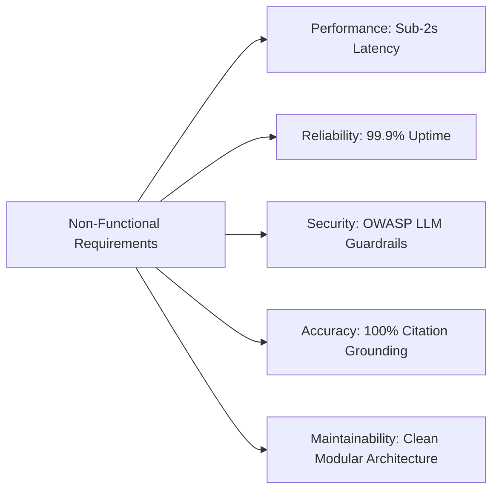

# Non-Functional Requirements Specification

The system enforces strict operational quality attributes to guarantee government-grade reliability, data accuracy, and user responsiveness.

---

## 1. Performance & Latency Specifications

| Metric | Target Threshold | Max Permissible | Verification Method |
| :--- | :--- | :--- | :--- |
| **API Response Time (Local Extractive)** | &lt; 800 ms | 1500 ms | Automated Locust load test suite |
| **API Response Time (Gemini LLM)** | &lt; 1800 ms | 3000 ms | Real-time APM telemetry |
| **Database Query Execution** | &lt; 25 ms | 100 ms | PostgreSQL `EXPLAIN ANALYZE` inspection |
| **Embedding Generation Time** | &lt; 50 ms | 150 ms | SentenceTransformer CPU benchmark |
| **Throughput Capacity** | 50 req/sec | — | Asynchronous worker scaling |

---

## 2. Accuracy & Hallucination Prevention

- **Grounding Rate**: 100% of factual statements must be backed by retrieved text chunks from Tier-1 documents.
- **Safe Refusal Precision**: On fictional, invalid, or unsupported queries (e.g., "interstellar warp drive"), the system must refuse with 100% consistency.
- **Citation Completeness**: Every answer recommending a standard must include the standard number, edition, publication year, regulatory status, and official preview URL.

---

## 3. Reliability & Availability

- **Service Availability**: 99.9% uptime during business operating hours (08:00 - 20:00 IST).
- **Dual-Engine Resiliency**: If Google Gemini API quota limits are exhausted (HTTP 429) or external network outages occur, the backend must fail over to the local extractive reasoning engine in &lt; 10 ms without dropping the user's request.
- **Data Persistence**: Relational database writes (such as dynamic standard ingestion) must execute within atomic ACID transactions.

---

## 4. Security & Compliance

- **Stateless Operation**: User chat sessions are processed statelessly or via encrypted conversation tokens. No personal identifiers (PII) are stored.
- **OWASP LLM Top 10 Mitigation**:
  - LLM01 Prompt Injection: Strict system instruction boundary markers and output schema validation.
  - LLM06 Sensitive Information Disclosure: Stripping internal server paths and credentials from all error responses.
  - LLM08 Excessive Agency: The AI assistant has read-only access to portal data and cannot perform mutating actions.
- **Transport Encryption**: All client-server traffic must be encrypted over HTTPS with TLS 1.3.
