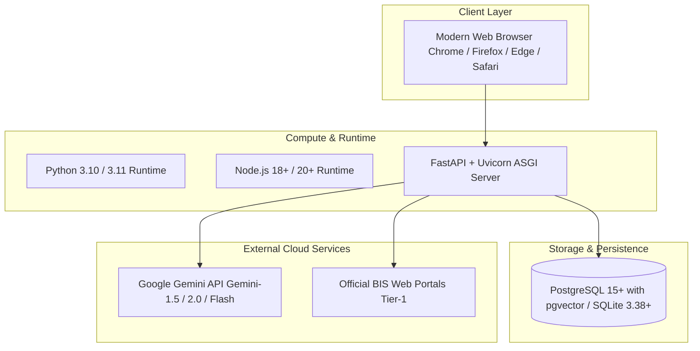

# System Requirements & Dependencies

This specification details the compute, storage, runtime, and network prerequisites for deploying the BIS Intelligent Assistant across development, staging, and production environments.

---

## Hardware Specifications

### Development Workstation (Minimum)
- **CPU**: 4 Cores (x86_64 or Apple Silicon ARM64).
- **RAM**: 8 GB RAM (16 GB recommended when running local embedding generation).
- **Storage**: 10 GB available SSD space.
- **Network**: Stable broadband internet access for Gemini API requests and BIS portal verification.

### Production Server (Recommended for 100 Concurrent Users)
- **Compute Instance**: 4 vCPUs, 16 GB RAM (e.g., AWS `t3.xlarge` or Azure `Standard_D4s_v5`).
- **Disk Storage**: 100 GB NVMe SSD (for PostgreSQL databases, PDF standard cache, and logs).
- **Operating System**: Ubuntu 22.04 LTS or Debian 12.

---

## Software Runtime Dependencies

### Backend Stack
- **Python**: `>= 3.10.0, &lt; 3.12.0`
- **FastAPI**: `>= 0.110.0`
- **Uvicorn**: `>= 0.28.0` (with uvloop)
- **SQLAlchemy ORM**: `>= 2.0.25`
- **Alembic**: `>= 1.13.0`
- **Pydantic**: `>= 2.6.0`
- **Sentence-Transformers**: `>= 2.5.0` (PyTorch CPU/CUDA)
- **google-genai / google-generativeai**: `>= 0.8.0`

### Frontend & Documentation Stack
- **Node.js**: `>= 18.18.0` or `>= 20.0.0`
- **npm**: `>= 9.0.0`
- **Docusaurus**: `3.10.x`
- **TypeScript**: `~6.0.x`
- **React**: `^18.2.0` or `^19.0.0`

---

## Database Management System

### Primary Production Engine
- **PostgreSQL 15+** with the **pgvector** extension for vector indexing.
- Connection pool managed via `asyncpg` with a minimum pool size of 10 and max pool size of 50.

### Local Development / Evaluation Engine
- **SQLite 3.38+** with JSON1 support enabled.
