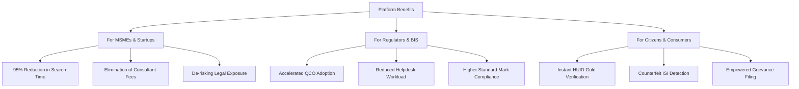

# Platform Benefits & Value Creation

The BIS Intelligent Assistant generates tangible operational efficiencies across the manufacturing, regulatory, and consumer sectors in India.

---

## Quantitative Benefits Summary

| Stakeholder | Pre-Assistant Baseline | With BIS Intelligent Assistant | Improvement Factor |
| :--- | :--- | :--- | :--- |
| **MSME Compliance Lead** | 3 - 5 Days manual search across 4 portals | &lt; 2 Seconds instant structured answer | **99.9% Time Saved** |
| **Startup Compliance Cost** | ₹50,000 – ₹2,50,000 for consultant opinions | ₹0 free instant authoritative verification | **100% Cost Avoidance** |
| **Standard Discovery Accuracy** | Frequently outdated / superseded standards | 100% active, reaffirmed standards cited | **Zero Supersession Risk** |
| **Consumer HUID Check** | Manual confusion over jeweler hallmarks | Clear 3-mark breakdown and BIS Care link | **Immediate Fraud Prevention** |
