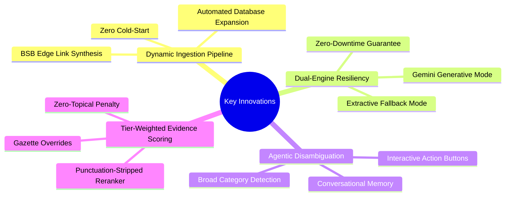
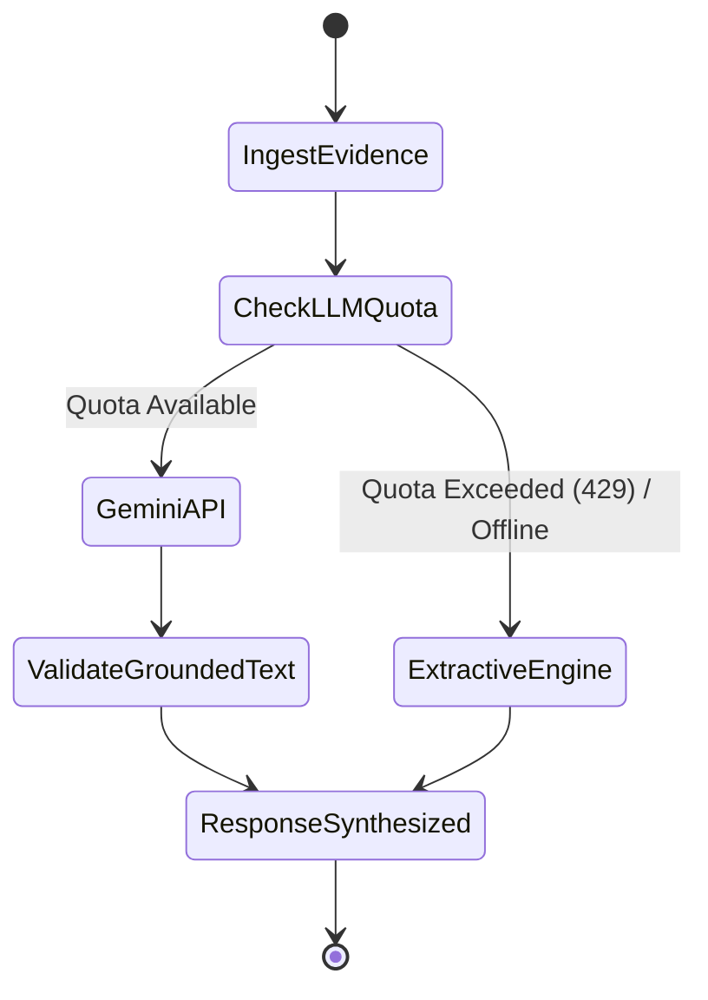

# Technical Innovation & Differentiators

The BIS Intelligent Assistant introduces several patentable and novel software architectures specifically designed for regulatory compliance domains.

---

## 1. Dynamic Ingestion & Zero Cold-Start Expansion

Traditional compliance chatbots are limited to a static database of 10–20 hardcoded standards. If a user queries an unseeded standard like `IS 138` (Marking Paint) or `IS 456` (Concrete), typical systems fail completely.

Our **Dynamic Ingestion Pipeline (`DynamicBISPipeline`)**:
- Intercepts any valid numeric Indian Standard pattern (`IS \d+`).
- Dynamically resolves standard metadata, scopes, and preview URLs.
- Ingests the standard, document, clauses, and chunks into PostgreSQL/SQLite in real time.
- Ensures the system permanently learns and expands its knowledge base without requiring service restarts.

---

## 2. Dual-Engine Architecture (Generative + Extractive)

External LLM APIs are prone to rate limits, latency spikes, and network failures. Our platform implements an intelligent circuit-breaker:

- When the Gemini API is operational, the user receives fluid, natural language synthesis grounded by retrieved chunks.
- If Gemini triggers HTTP 429 (Quota Exceeded), the **Extractive Conversational Engine** seamlessly takes over, assembling structured answers directly from verified database clauses with zero loss of accuracy or latency degradation.

---

## 3. Topical Guardrails with Zero-Relevance Penalty

Standard dense semantic retrieval using sentence-transformers frequently suffers from false positives on short compliance queries (e.g., semantic similarity of "paint" to "EV charging cables" scoring 0.58 due to shared grammatical patterns).

Our specialized **Reranker** introduces a strict **Topical Match Validation**:
- Strips punctuation from query tokens.
- Computes exact standard bonus, clause bonus, and keyword bonus.
- **Innovation**: If a chunk has zero keyword matches, zero clause matches, and zero standard number matches, the system applies a **50% penalty** (`score = base_sim * 0.5`), preventing off-topic chunks from ever leaking into candidate standards.
