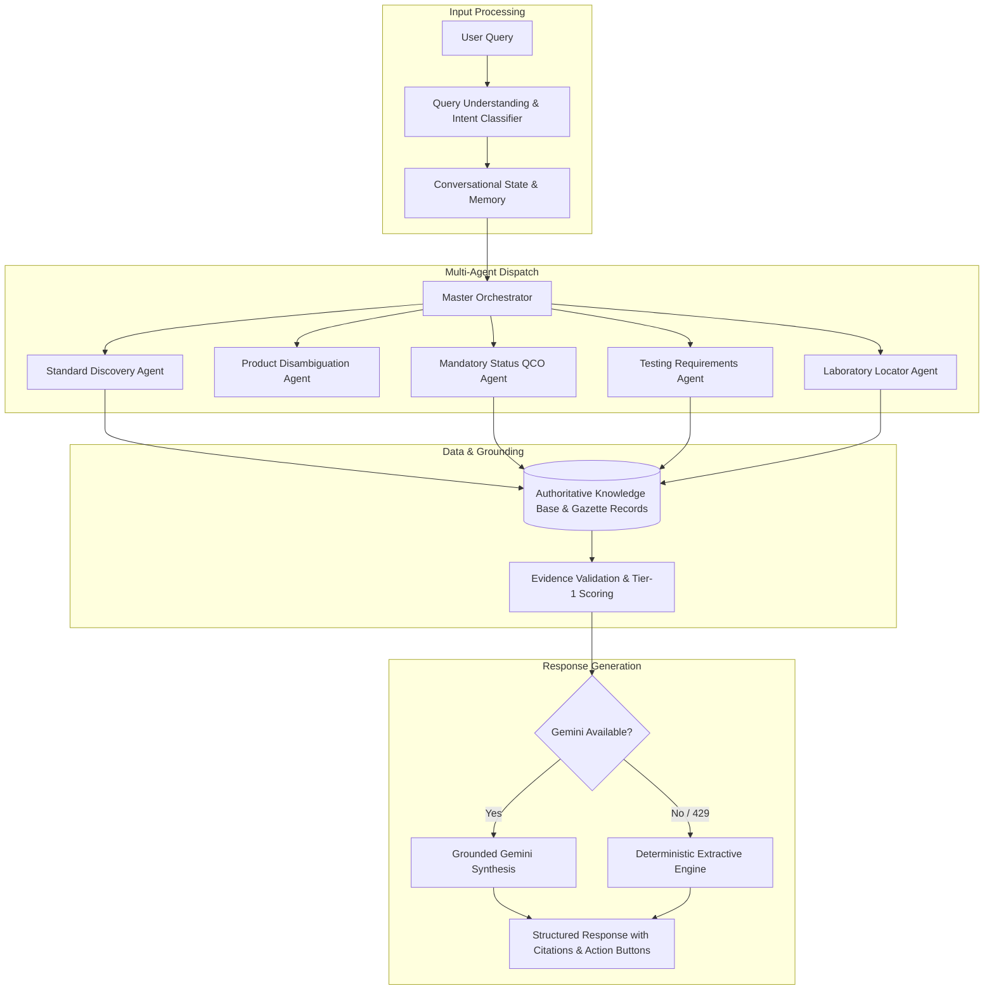

# Proposed Solution

The **BIS Intelligent Assistant** delivers an innovative, multi-layered solution that bridges the divide between complex technical standards documentation and everyday industrial and consumer inquiries.



---

## Holistic Solution Architecture

The solution synthesizes four core subsystems into a unified platform:

1. **Intent-Driven Natural Language Engine**: Translates natural, non-technical inquiries into formal standardization queries across 16 intent classes.
2. **Dynamic Ingestion & Expansion Pipeline**: Features an active catalog covering major engineering divisions (CHD, CED, MTD, ETD, LITD) and dynamically registers unseeded standards into SQLite/PostgreSQL upon demand.
3. **Multi-Agent Regulatory Orchestrator**: Coordinates specialized subagents that independently resolve standards, QCO orders, testing requirements, and lab locations before cross-validating findings.
4. **Deterministic & Generative Dual Synthesis**: Generates conversational answers using Google Gemini while maintaining a 100% deterministic extractive backup engine that ensures zero downtime during quota exhaustion.

---

## Solving the Hallucination Dilemma

Generic Large Language Models hallucinate standards because they rely on probabilistic token predictions. Our solution introduces a **strict evidence gate**:

```python
# Conceptual Evidence Validation Gate
def validate_standard_response(candidate_standards, evidence_chunks):
    if not candidate_standards:
        # Strict Safe Refusal - Zero Hallucination
        return {
            "answer": "I could not find sufficient authoritative BIS evidence to answer this reliably.",
            "confidence": "INSUFFICIENT",
            "sources": []
        }
    # Proceed only with verified Tier-1 evidence
    return format_grounded_response(candidate_standards, evidence_chunks)
```


