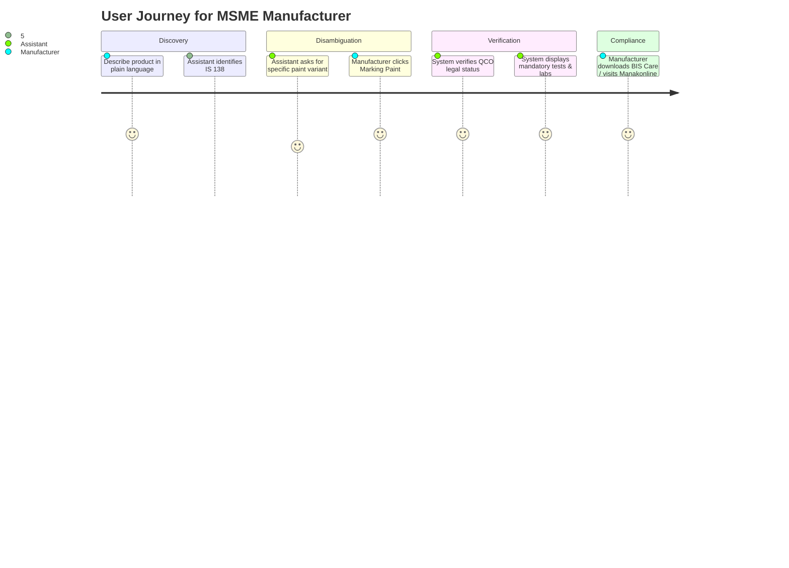

# Solution Overview & User Experience

The BIS Intelligent Assistant transforms how businesses and consumers interact with regulatory compliance from a frustrating, multi-day manual search into an intuitive, seconds-long conversational flow.

---

## End-to-End User Experience

### 1. Natural Language Entry
A user does not need to know Indian Standard numbers. They can ask:
- *"I am manufacturing PVC insulated cables for house wiring. What BIS standard applies?"*
- *"Does structural steel require mandatory certification in India?"*
- *"सोने के गहने पर 6 अंकों का HUID कोड क्या दर्शाता है?"*

### 2. Conversational Intent & Context Resolution
The system immediately extracts:
- Target Product: `PVC insulated cables`
- Intended Voltage: `Domestic house wiring (up to 1100 V)`
- Intent: `STANDARD_DISCOVERY` + `MANDATORY_STATUS`
- Language: `en`

### 3. Structured Answer Delivery
Instead of an unstructured block of text, the assistant responds with an authoritative **Section-12 Structured Profile**:
1. **Direct Answer**: Concise summary answering the immediate question.
2. **Applicable Indian Standard**: Standard number (`IS 694:2010`), full title, edition, and status.
3. **BIS Regulatory Requirement**: Mandatory QCO order, issuing ministry, and gazette notification reference.
4. **Relevant Technical Clauses**: Key specifications (conductor resistance, insulation thickness).
5. **Testing & Laboratory Guidance**: Core safety tests and recognized testing facilities.
6. **Authoritative Sources**: Interactive citation badges with direct URLs.
