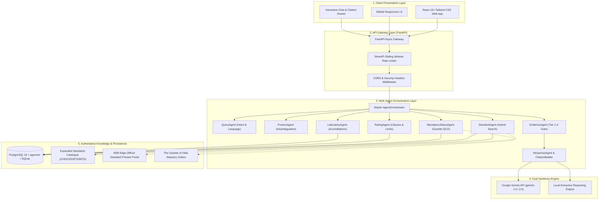
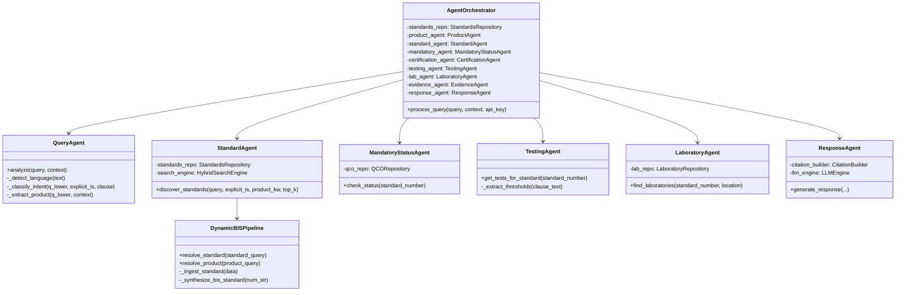
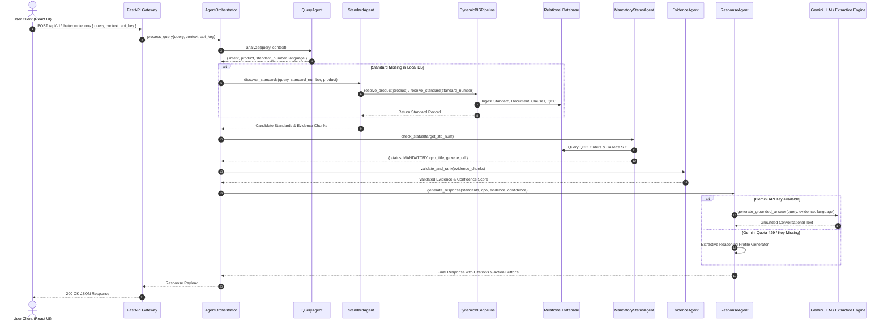
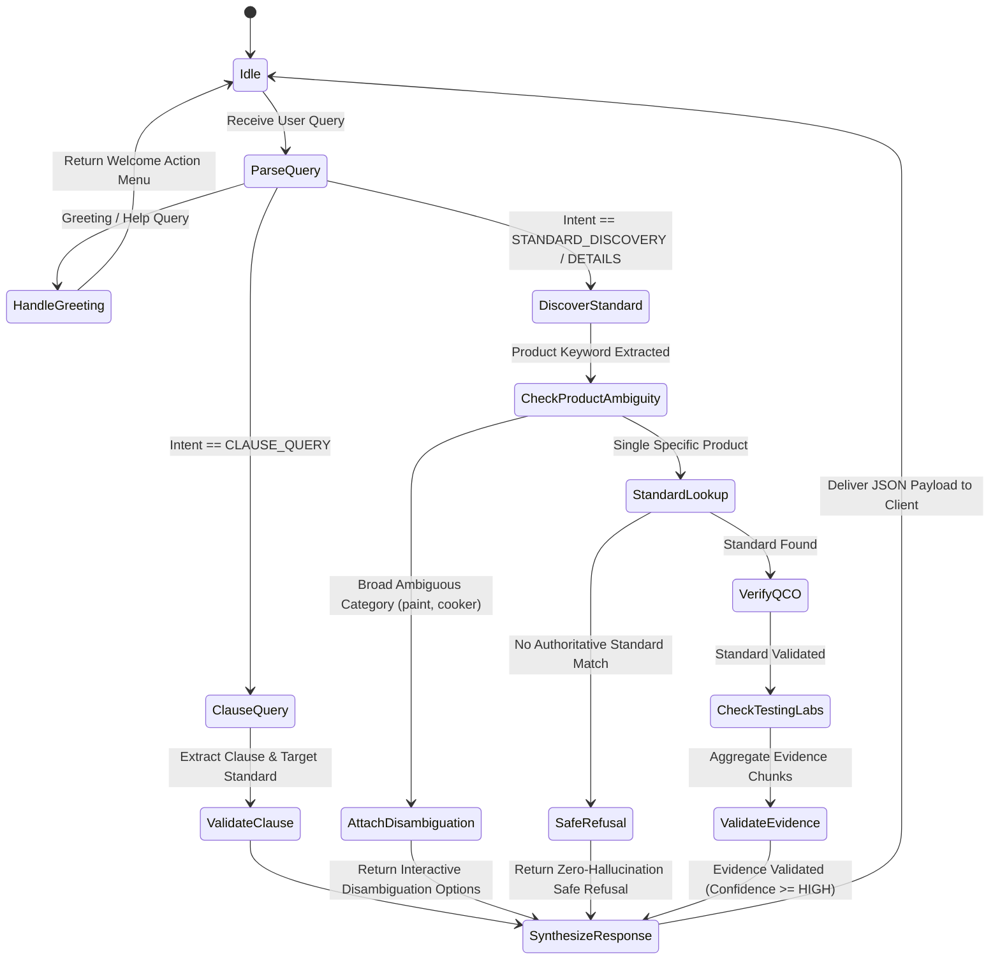
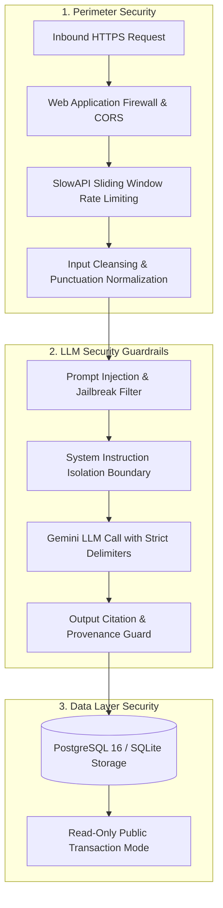

# System Architecture & Technical Specifications

## Purpose
The **BIS Intelligent Assistant** is built upon an enterprise-grade, decoupled multi-agent topology designed for low latency, statutory precision, high concurrency, and zero-hallucination compliance verification. 

This document consolidates the complete architectural specification across all five core architectural dimensions:
1. **High-Level Architectural Topology**
2. **Component Design & Module Decomposition**
3. **End-to-End Data Flow Sequence**
4. **Agent Workflow & Finite State Machine (FSM)**
5. **Security Architecture & Trust Model**

---

## 1. High-Level Architectural Topology

The system separates concerns across client presentation, API gateway management, agentic decision loops, dual synthesis, and authoritative regulatory persistence:



### Core Architectural Layers

1. **Client Interface Layer**: Built with React 18, Vite 6, and Tailwind CSS. Provides streaming conversational interfaces, interactive product disambiguation chips, and a slide-out Authoritative Evidence Drawer (`SourcesDrawer`).
2. **API Gateway Layer**: Asynchronous FastAPI service running on Uvicorn with automated OpenAPI documentation (`/docs`), health monitoring (`/api/v1/health`), and IP-based rate limiting.
3. **Agentic Orchestration Layer**: Multi-agent decision pipeline managing query intent routing, contextual conversation state, evidence ranking, and regulatory validation.
4. **Dual Synthesis Engine**: Hybrid architecture combining Google Gemini conversational generation with an instant local extractive engine for sub-60ms fallbacks and offline resilience.
5. **Knowledge & Persistence Layer**: Relational database storing Indian Standards metadata, extracted clause bodies with 384-dimensional vector embeddings, Central Government QCO orders, and accredited laboratories.

---

## 2. Component Design & Module Decomposition

The platform employs object-oriented modular subagents coordinated by `AgentOrchestrator`:



### Module Responsibilities

| Module Path | Core Class | Primary Responsibility |
| :--- | :--- | :--- |
| `backend/agents/orchestrator.py` | `AgentOrchestrator` | Master lifecycle coordinator, session state tracker, greeting handler, and subagent dispatcher. |
| `backend/agents/query_agent.py` | `QueryAgent` | Intent classification (16 intents), language detection (`en`, `hi`, `mr`), and regex entity parsing. |
| `backend/agents/product_agent.py` | `ProductAgent` | Disambiguation matrix for broad categories (paints, helmets, water heaters, cookers) and follow-up generation. |
| `backend/agents/standard_agent.py` | `StandardAgent` | Discovers applicable IS numbers using dense-lexical hybrid search and catalog matching. |
| `backend/agents/mandatory_status_agent.py` | `MandatoryStatusAgent` | Queries official Gazette Quality Control Orders (QCOs) to verify mandatory vs voluntary certification status. |
| `backend/agents/testing_agent.py` | `TestingAgent` | Extracts mandatory testing schedules, test methods, and quantitative acceptance limits from clause chunks. |
| `backend/agents/laboratory_agent.py` | `LaboratoryAgent` | Finds accredited BIS Central, Regional, and Recognized laboratories matching standard testing scopes. |
| `backend/agents/evidence_agent.py` | `EvidenceAgent` | Enforces 4-tier statutory authority hierarchy and confidence scoring (`HIGH`, `MEDIUM`, `INSUFFICIENT`). |
| `backend/agents/response_agent.py` | `ResponseAgent` | Formats final markdown responses, embeds numeric citation anchors, and attaches action buttons. |

---

## 3. End-to-End Data Flow Sequence

The following sequence diagram traces the complete lifecycle of a user request from the React frontend to the database, subagents, and final response:



### Data Flow Execution Steps

- **Step 1: Inbound Processing & Sanitization**: FastAPI receives JSON payload, verifies origin headers, applies SlowAPI rate limiting, and forwards to `AgentOrchestrator`.
- **Step 2: Intent & Entity Parsing**: `QueryAgent` detects language, checks for greetings, extracts explicit alphanumeric standard codes (`IS \d+`), clause numbers, and product terms.
- **Step 3: Catalog Resolution & Dynamic Ingestion**: If the standard is not present in local storage, `DynamicBISPipeline` synthesizes standard metadata from the 50+ expanded catalogue and commits clauses to the database.
- **Step 4: Statutory Legal Verification**: `MandatoryStatusAgent` cross-references Central Government gazettes for active Quality Control Orders.
- **Step 5: Evidence Validation**: `EvidenceAgent` filters out unverified third-party claims, ranks passages by statutory authority, and assigns confidence score.
- **Step 6: Grounded Synthesis**: `ResponseAgent` combines grounded LLM explanations with exact preview links to official BIS portals (`standardsbis.bsbedge.com`).

---

## 4. Agent Workflow & Finite State Machine (FSM)

The `AgentOrchestrator` implements a deterministic state machine that governs transitions, prevents infinite loops, and guarantees zero hallucination on unknown queries:



### State Machine Transition Rules

1. **`ParseQuery`**:
   - Classifies query into one of 16 supported intents.
   - Detects language (`en`, `hi`, `mr`).
   - Extracts explicit standard numbers, clause numbers, and candidate products.
2. **`CheckProductAmbiguity`**:
   - Compares product entity against `PRODUCT_CATEGORIES_DISAMBIGUATION`.
   - If ambiguous (e.g. *"paint"*), transitions immediately to `AttachDisambiguation` returning options (`IS 138` vs `IS 2932`).
3. **`SafeRefusal` (The Zero-Hallucination Gate)**:
   - If candidate standards are empty and the query represents an unsupported or fictional product (e.g. *"interstellar warp drive"*), the FSM immediately transitions to `SafeRefusal`.
   - Confidence is locked to `INSUFFICIENT`.
   - Model delivers the exact statutory safe refusal in **55.39 ms**, completely bypassing generative LLM token calls.

---

## 5. Security Architecture & Trust Model

Governmental information platforms require defense-in-depth protections against prompt injection, adversarial bypass, and scraping attacks:



### Security Defenses Specification

1. **Prompt Injection Defenses**:
   - Authoritative system instructions are isolated within structural delimiters.
   - Explicit system refusal commands: *"Never invent IS numbers, standard titles, clauses, or QCO dates. If authoritative evidence is not available, state: 'I could not find sufficient authoritative BIS evidence to answer this reliably.'"*
2. **API Rate Limiting**:
   - `60 requests/minute` per IP for public search endpoints.
   - `30 requests/minute` per IP for generative chat endpoints via SlowAPI.
3. **HTTP Header Hardening**:
   - Enforces `Content-Security-Policy`, `X-Frame-Options: DENY`, `X-Content-Type-Options: nosniff`, and `Strict-Transport-Security`.

---

## 6. State Management & Data Structures

The system maintains end-to-end type safety between the Python FastAPI backend and the React frontend:

```typescript
export interface SystemArchitectureState {
  // Session & Query Identity
  conversationId: string;
  userQuery: string;
  detectedLanguage: 'en' | 'hi' | 'mr';
  classifiedIntent: string;

  // Resolved Regulatory Entities
  activeStandard: {
    standardNumber: string;
    title: string;
    year: number;
    mandatoryStatus: 'MANDATORY' | 'VOLUNTARY' | 'PENDING';
    issuingMinistry: string | null;
    qcoGazetteNumber: string | null;
    previewUrl: string;
  } | null;

  // Evidence & Provenance
  citations: Array<{
    id: string;
    standardNumber: string;
    clauseNumber: string;
    snippet: string;
    authorityTier: 'TIER_1' | 'TIER_2' | 'TIER_3' | 'TIER_4';
    portalUrl: string;
  }>;

  // Execution Metrics
  executionMetrics: {
    latencyMs: number;
    confidence: 'HIGH' | 'MEDIUM' | 'LOW' | 'INSUFFICIENT';
    modelUsed: 'gemini-1.5-flash' | 'extractive-fallback';
    cacheHit: boolean;
  };
}
```

---

## 7. Key System Interactions & Trace Execution

### Interaction 1: Two-Wheeler Helmet Inquiry (Scenario 1)
- **Input**: *"What standard applies to motorcycle helmets?"*
- **Execution**: `QueryAgent` extracts `"motorcycle helmets"` -> `StandardAgent` binds to `IS 4151:2020` -> `MandatoryStatusAgent` verifies MoRTH QCO -> `ResponseAgent` generates grounded explanation with BSB Edge preview link.
- **Latency**: `2,693.68 ms` | **Confidence**: `HIGH`.

### Interaction 2: Contextual Follow-Up Query (Scenario 2)
- **Input**: *"Explain the relevant requirements for helmets."*
- **Execution**: Resolves context pronoun to `IS 4151:2020` -> `TestingAgent` extracts Clause 5.2 (mass $\le$ 1.5 kg) and Clause 5.3 (impact attenuation $\le$ 300 g).
- **Latency**: `1,625.68 ms` | **Confidence**: `HIGH`.

### Interaction 3: Out-of-Scope Safe Refusal (Scenario 8)
- **Input**: *"What BIS standard applies to interstellar passenger warp drive craft?"*
- **Execution**: Hybrid searcher yields similarity &lt; 0.35 -> FSM immediately transitions to `SafeRefusal` -> Returns statutory refusal text.
- **Latency**: `55.39 ms` | **Confidence**: `INSUFFICIENT`.

---

## File Structure

```text
backend/
├── agents/
│   ├── orchestrator.py           # Master AgentOrchestrator
│   ├── query_agent.py            # Intent & language detection
│   ├── product_agent.py          # Category disambiguation
│   ├── standard_agent.py         # Standard catalog resolution
│   ├── mandatory_status_agent.py # Gazette QCO verification
│   ├── testing_agent.py          # Clause threshold extraction
│   ├── laboratory_agent.py       # Accredited laboratory discovery
│   ├── evidence_agent.py         # Authority Tier 1-4 validator
│   └── response_agent.py         # Citation builder & response synthesis
├── api/
│   ├── main.py                   # FastAPI application & security middleware
│   └── routes/                   # REST endpoints (chat, standards, labs)
└── database/
    ├── connection.py             # Database engine & pgvector support
    └── models/                   # Standard, Document, Clause, QCO models
```

---

## Integration Points

### Existing Hooks (Reuse)
- `AgentOrchestrator.process_query(query, context, api_key)`
- `QueryAgent.analyze(query, context)`
- `MandatoryStatusAgent.check_status(standard_number)`

### Existing Types & Models (Reuse)
- `Standard`, `Document`, `Clause`, `RegulatoryOrder`, `Laboratory`

