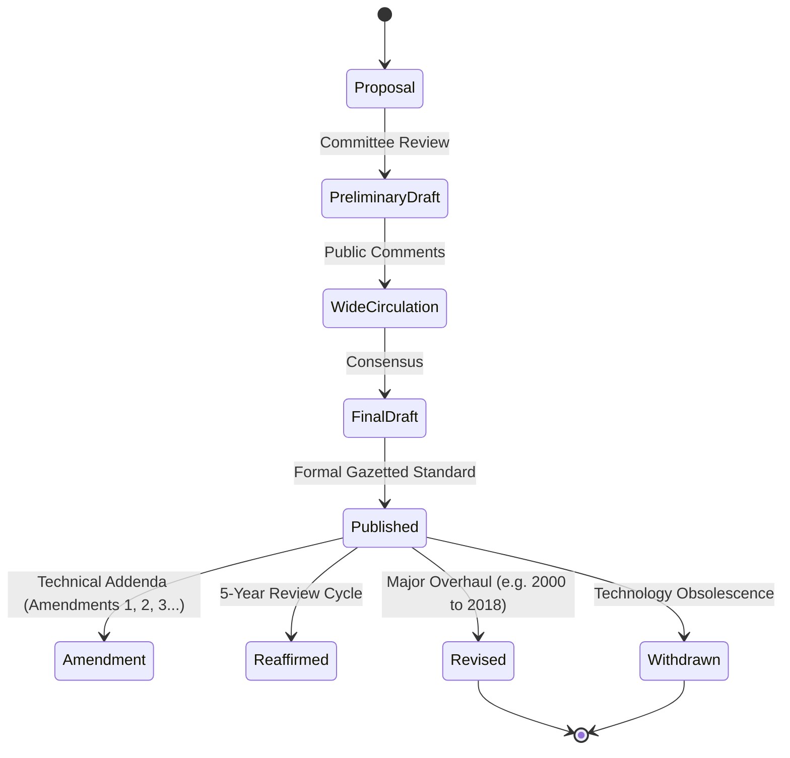

# Amendments & Document Lifecycle

Indian Standards are dynamic documents subject to periodic review, technical amendments, and reaffirmation cycles.

---

## Document Status Classifications

1. **ACTIVE**: The standard is legally valid, current, and recognized for new grant of licenses.
2. **REAFFIRMED**: Technical committees review standards every 5 years. If no technical overhaul is needed, the standard is formally reaffirmed (e.g., `IS 456:2000 (Reaffirmed 2021)`).
3. **AMENDED**: Minor technical updates, formula corrections, or safety additions published as numbered *Amendment Sheets* (e.g., `Amendment No. 1 to IS 138:2018`).
4. **SUPERSEDED / REVISED**: Replaced by a newer edition. Manufacturers are granted a formal transition window (typically 6 to 12 months) to upgrade their production and testing lines.
5. **WITHDRAWN**: Cancelled by BIS with no replacement.
