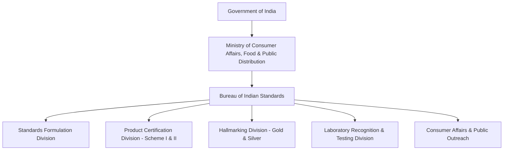

# Bureau of Indian Standards (BIS) Overview

The **Bureau of Indian Standards (BIS)** is the National Standards Body of India, established under the **Bureau of Indian Standards Act, 2016** (which repealed and superseded the earlier BIS Act of 1986). It operates under the aegis of the **Ministry of Consumer Affairs, Food & Public Distribution**, Government of India.

---

## Statutory Mandate

Under the **BIS Act, 2016**, the Bureau is empowered to:
1. Formulate, revise, and publish National Standards for articles, processes, and services.
2. Grant, renew, suspend, or cancel licenses and certificates of conformity for the **Standard Mark (ISI Mark)**.
3. Administer mandatory **Hallmarking** for gold and silver jewelry.
4. Establish, maintain, and recognize testing laboratories across India.
5. Harmonize Indian Standards with international benchmarks (ISO, IEC, Codex Alimentarius).

---

## Technical Divisions Matrix

Standards formulation is organized across 15 Division Councils:

| Department Code | Technical Division Name | Scope of Standards |
| :--- | :--- | :--- |
| **CHD** | Chemical Department | Paints, pigments, chemicals, soaps, plastics, petrochemicals |
| **CED** | Civil Engineering Department | Cement, concrete, structural steel, building codes, sanitation |
| **ETD** | Electrotechnical Department | Electric cables, motors, transformers, switchgear, EV chargers |
| **LITD** | Electronics & Information Technology | Consumer electronics, servers, cyber security, IT equipment |
| **MED** | Mechanical Engineering Department | Pumps, compressors, gas cylinders, elevators, boilers |
| **MTD** | Metallurgical Engineering Department | TMT bars, cast iron, galvanized tubes, non-ferrous metals |
| **FAD** | Food & Agriculture Department | Packaged water, dairy, cereals, beverages, fertilizers |
| **TXD** | Textile Department | Natural fibers, geotextiles, safety clothing, technical textiles |
