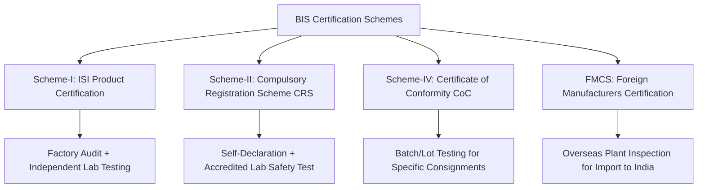

# BIS Conformity Assessment Schemes

BIS operates multiple certification schemes tailored to different industrial sectors, risk profiles, and manufacturing locations.

---

## 1. Scheme-I: ISI Product Certification

- **Target Goods**: Mechanical, civil, chemical, and domestic safety products (Cement, Helmets, Cables, Domestic Appliances, Pressure Cookers).
- **Process**:
  1. Manufacturer sets up in-house testing laboratory according to BIS Scheme of Inspection and Testing (SIT).
  2. Submission of application on [Manakonline](https://www.manakonline.in).
  3. Factory inspection by BIS technical officers.
  4. Drawing of verification samples for independent laboratory testing.
  5. Grant of License (**CM/L Number**).
- **Marking**: Standard Mark (the iconic rectangular **ISI Logo** with the IS number on top and CM/L license number below).

---

## 2. Scheme-II: Compulsory Registration Scheme (CRS)

- **Target Goods**: IT, electronics, wireless, and solar equipment (Laptops, Mobile Phones, LED Drivers, Smart Watches, Lithium Batteries).
- **Administered Under**: Ministry of Electronics and Information Technology (MeitY) and MNRE.
- **Process**:
  1. Samples tested at authorized BIS-recognized testing lab in India.
  2. Test report submitted online via [CRS Portal](https://www.crsbis.in).
  3. Grant of Registration (**R-Number**).
- **Marking**: Words "Self-Declaration - Conforming to IS..." with the official registration logo.

---

## 3. MSME & Startup Fee Concessions

Under official BIS policy guidelines:
- **Micro Enterprises**: **50% concession** on annual minimum marking fees.
- **Small Enterprises**: **20% concession** on marking fees.
- **Startups (DPIIT Recognized)**: Special priority processing and fee subsidies.
