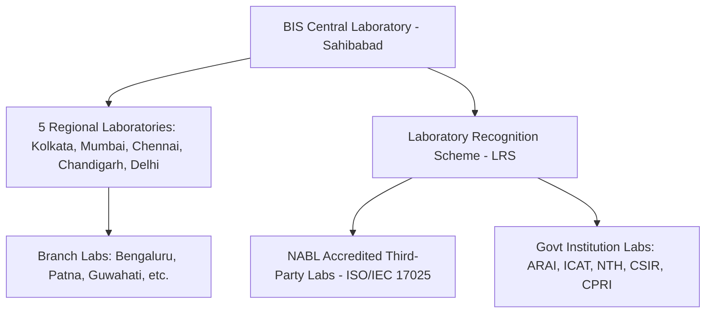

# Laboratory Network & Recognition Scheme (LRS)

The Bureau of Indian Standards relies on an extensive network of in-house and recognized private/public testing facilities across India.

---

## Laboratory Categories

1. **BIS In-House Laboratories**:
   - **Central Laboratory**: Located at Sahibabad (Ghaziabad, UP). The premier referral testing facility equipped for advanced chemical, electrical, and mechanical evaluations.
   - **Regional Laboratories**: Operating in Northern (Chandigarh), Western (Mumbai), Southern (Chennai), Eastern (Kolkata), and Central zones.

2. **Recognized Laboratories under LRS**:
   - Private and public laboratories recognized under the **BIS Laboratory Recognition Scheme, 2020**.
   - Must hold mandatory **ISO/IEC 17025** accreditation from NABL (National Accreditation Board for Testing and Calibration Laboratories).
   - Subject to periodic surveillance audits and blind proficiency testing (PT) rounds.

3. **Government Partner Laboratories**:
   - **ICAT Manesar / ARAI Pune**: Automotive safety and helmet testing (`IS 4151`).
   - **CPRI Bengaluru**: High-voltage electrical switchgear and transformer testing.
   - **National Test House (NTH)**: Civil engineering materials and chemical testing.
