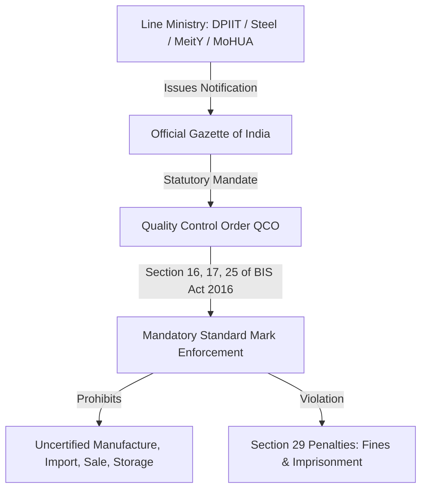

# Quality Control Orders (QCOs)

A critical regulatory principle in Indian standardization is that **the existence of an Indian Standard does not automatically make BIS certification mandatory**. Certification is strictly voluntary unless enforced by a **Quality Control Order (QCO)** issued by the Central Government.



---

## Legal Basis under the BIS Act, 2016

Under **Section 16, Section 17, and Section 25** of the BIS Act, 2016, line ministries are empowered to notify goods where compliance with an Indian Standard is mandatory in the public interest, for protection of human, animal or plant health, safety of the environment, prevention of unfair trade practices, or national security.

---

## Anatomy of a Central QCO Gazette Notification

Every valid QCO citation in the BIS Intelligent Assistant reports five statutory attributes:

```yaml
qco_record:
  title: "Plywood and Allied Products (Quality Control) Order, 2024"
  issuing_ministry: "Ministry of Commerce and Industry (DPIIT)"
  gazette_notification: "S.O. 1120(E)"
  order_date: "2024-03-15"
  effective_date: "2024-09-15"
  micro_small_exemption_date: "2025-03-15"
  mandatory_standards:
    - "IS 710:2010 (Marine Plywood)"
    - "IS 303:1989 (Plywood for General Purposes)"
```

---

## Penalties for Non-Compliance

Under **Section 29 of the BIS Act, 2016**:
- **First Offense**: Imprisonment for a term which may extend to **two years**, or a fine not less than **₹2,00,000**, or up to ten times the value of manufactured/sold goods.
- **Seizure**: District administration and BIS enforcement officers hold statutory power to raid, seize, and confiscate non-compliant commercial stock.
