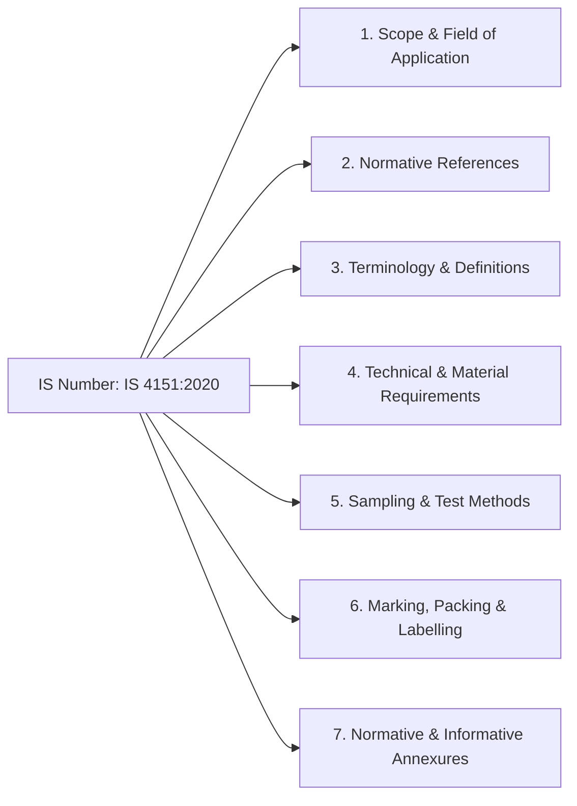

# Structure of Indian Standards

Indian Standards are rigorous technical documents created through consensus by expert sectional committees comprising industry leaders, scientists, consumers, and government officials.

---

## Anatomy of an Indian Standard Number

Take the standard identifier: `IS 4151:2020 (Fourth Revision)`

- **`IS`**: National prefix indicating an Indian Standard.
- **`4151`**: The unique numeric base code assigned to the product (*Protective Helmets for Two-Wheeler Riders*).
- **`:2020`**: Year of publication / formal reaffirmation.
- **`Revision`**: Indicates major updates (First, Second, Third, Fourth Revision) superseding older editions.
- **`Part / Section`**: Complex standards are broken down into parts (e.g., `IS 13252 (Part 1):2010` for Information Technology Equipment Safety).

---

## Core Document Clauses

1. **Clause 1 — Scope**: Establishes the boundaries, products covered, and explicit exclusions.
2. **Clause 2 — Normative References**: Mandatory standards that must be complied with alongside the primary standard.
3. **Clause 4 — Technical Requirements**: Material specifications, physical dimensions, mechanical tolerances, and performance thresholds.
4. **Clause 5 — Test Methods**: Step-by-step laboratory procedures, conditioning parameters (temperature, humidity), and equipment calibration.
5. **Clause 6 — Marking and ISI Marking**: Mandates label details, serial numbers, traceability marks, and the placement of the Standard Mark (ISI logo).
