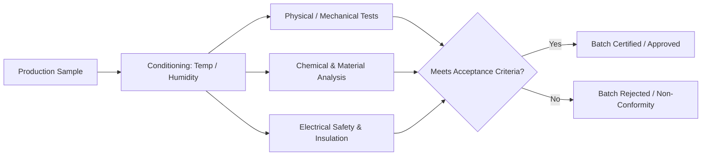

# Product Testing & Methods

Testing is the empirical backbone of conformity assessment. An Indian Standard specifies not only what tests to conduct, but the exact procedural apparatus, sampling rate, and failure criteria.

---

## Core Testing Dimensions

### 1. Mechanical & Structural Tests
- **Tensile & Yield Strength**: Testing TMT rebars under `IS 1786` for proof stress (>= 500 N/mm^2 for Fe 500D) and percentage elongation.
- **Impact Attenuation**: Testing protective helmets (`IS 4151`) by dropping a headform from 2.8 meters onto flat and hemispherical anvils.

### 2. Electrical & Safety Tests
- **High Voltage Spark Testing**: Testing PVC insulation (`IS 694`) under 3 kV AC water immersion for 15 minutes.
- **Flammability & Glow-Wire Test**: Testing electrical plastic components (`IS 302-1`) at 850°C to verify self-extinguishing behavior.

### 3. Chemical & Environmental Tests
- **Salt Spray Corrosion**: Testing galvanized coatings (`IS 1239`) for red rust resistance under continuous saline fog for 96 hours.
- **Migration of Heavy Metals**: Testing children's toys (`IS 9873 (Part 3)`) for lead, cadmium, and arsenic toxicity thresholds.
