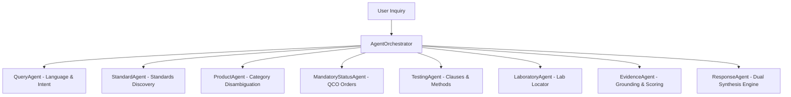

# AI Agent Overview

The **BIS Intelligent Assistant** rejects monolithic prompt engineering in favor of a **multi-agent collaborative architecture**, where discrete software agents specialize in specific regulatory and technical facets of the BIS ecosystem.

---

## Specialized Agent Roles

| Agent Name | Primary Responsibility | Input / Output |
| :--- | :--- | :--- |
| **`AgentOrchestrator`** | Master lifecycle controller, conversational memory manager. | Query + State 	o Structured Response |
| **`QueryAgent`** | NLP parser, intent classifier (16 intents), language detector. | Raw String 	o `{intent, product, standard, lang}` |
| **`StandardAgent`** | Standard retrieval, dynamic catalog ingestion. | Keywords 	o Candidate Standards + Chunks |
| **`ProductAgent`** | Broad category ambiguity detection, follow-up buttons. | Product 	o `{has_disambiguation, options}` |
| **`MandatoryStatusAgent`** | Legal QCO status verification against central gazettes. | Standard Number 	o `{status, qco_title, gazette_url}` |
| **`TestingAgent`** | Clause-level testing protocols and acceptance limits. | Standard Number 	o `{tests: [name, clause, method]}` |
| **`LaboratoryAgent`** | Authorized testing facility mapping by geography. | Standard Number 	o `{labs: [name, city, state, scope]}` |
| **`EvidenceAgent`** | Multi-tier evidence ranking and confidence computation. | Raw Chunks 	o Validated Evidence + Score |
| **`ResponseAgent`** | Citation generation and grounded synthesis (Gemini/Extractive). | Aggregated Data 	o Markdown Output |
