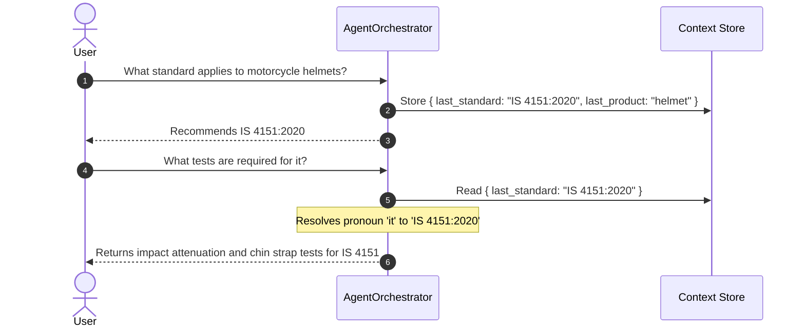

# Context Management & Conversational Memory

Real-world users interact through multi-turn dialogue, using pronouns and implicit references rather than repeating full standard numbers.

---

## Pronoun & Context Resolution Logic

The `QueryAgent` analyzes conversation history:
1. Detects pronouns (`it`, `this standard`, `the product`, `these items`).
2. Pulls `context.get("last_standard")` or `context.get("last_product")`.
3. Re-binds the explicit standard number before dispatching subagents.
