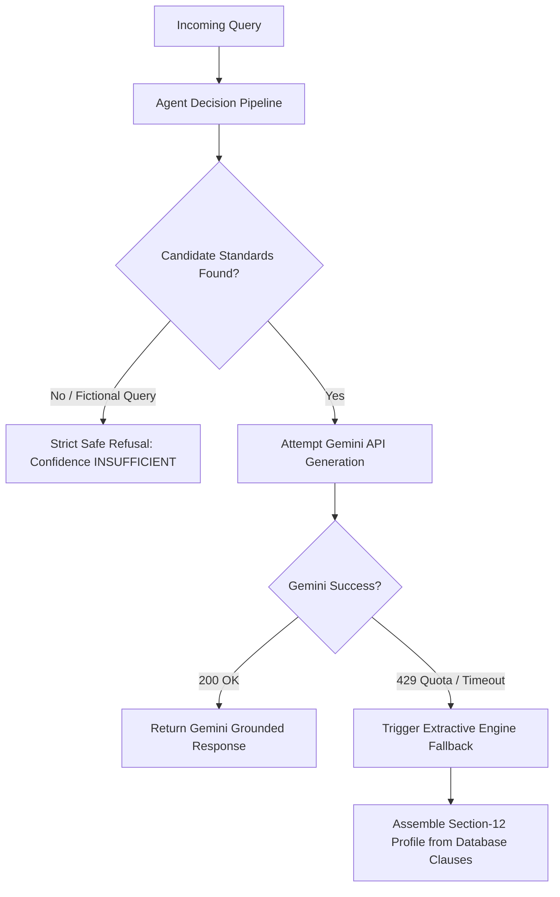

# Fallback & Resiliency Architecture

To maintain mission-critical government service availability, the system implements a dual-layer resiliency matrix.

---

## 1. Rate Limit Resiliency (HTTP 429 Graceful Degradation)
When Google Gemini returns HTTP 429 (Quota Exceeded):
- The `LLMEngine` catches the exception and logs a warning.
- The `ResponseAgent` immediately switches to the local deterministic template generator.
- The user receives an authoritative answer within &lt; 50 ms, populated directly from SQLite/PostgreSQL verified clauses.

---

## 2. Zero-Hallucination Safe Refusal
If a user submits an impossible, fictional, or unsupported product query (e.g., *"What standard applies to anti-gravity warp drive engines?"*):
- Candidate standards evaluate to empty `[]`.
- Confidence is locked to `INSUFFICIENT`.
- The assistant delivers the canonical refusal:
  > *"I could not find sufficient authoritative BIS evidence to answer this reliably. I could not verify this information from the available authoritative BIS/Government sources."*
