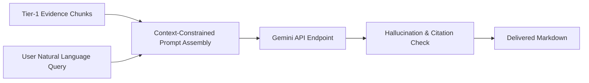

# Google Gemini Integration

The assistant leverages Google's **Gemini Models** (`gemini-1.5-flash`, `gemini-2.0-flash`, `gemini-3.6-flash`) for natural language synthesis, multilingual fluency, and grounded reasoning.



---

## Model Configuration Parameters

```python
# Production LLM Configuration
GENERATION_CONFIG = {
    "temperature": 0.1,         # Low temperature enforces factual determinism
    "top_p": 0.95,
    "top_k": 40,
    "max_output_tokens": 1500,
    "stop_sequences": ["<END_OF_BIS_RESPONSE>"]
}
```

---

## Strict System Instruction Delimiters

To guarantee that Gemini acts strictly as an authoritative technical officer and never invents standards, the system prompt enforces:

```markdown
You are the BIS Intelligent Assistant, an authoritative AI assistant for Indian Standards,
BIS certification, conformity assessment, testing, and laboratories.

1. SOURCE AUTHORITY:
- Treat Tier 1 BIS / Government of India official sources as absolute truth.
- Do NOT use third-party websites, Wikipedia, or commercial blogs.

2. ZERO HALLUCINATION:
- Never invent IS numbers, standard titles, clauses, page numbers, or QCO dates.
- If authoritative evidence is not available, explicitly state:
  "I could not verify this information from the available authoritative BIS/Government sources."

3. CITATIONS:
- Every factual claim must be backed by retrieved evidence chunks with official source URLs.
```
