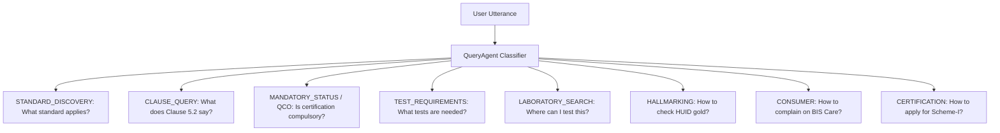

# Intent Detection & Classification

The `QueryAgent` analyzes every user utterance and maps it into one or more of **16 formal regulatory intents**.

---

## Supported Intent Taxonomy

| Intent Identifier | Trigger Example | Primary Agent Invoked |
| :--- | :--- | :--- |
| **`STANDARD_DISCOVERY`** | *"Which standard applies to domestic pressure cookers?"* | `StandardAgent` |
| **`STANDARD_DETAILS`** | *"Give me an overview of IS 138:2018."* | `StandardAgent` |
| **`CLAUSE_QUERY`** | *"What does clause 5.2 of IS 4151 require?"* | `TestingAgent` / `StandardAgent` |
| **`MANDATORY_STATUS`** | *"Is BIS certification mandatory for structural steel?"* | `MandatoryStatusAgent` |
| **`TEST_REQUIREMENTS`** | *"What laboratory tests are required for PVC cables?"* | `TestingAgent` |
| **`LABORATORY_SEARCH`** | *"Where can I test drinking water samples in Mumbai?"* | `LaboratoryAgent` |
| **`HALLMARKING`** | *"What marks should I verify on gold jewellery?"* | `HallmarkingAgent` |
| **`CONSUMER`** | *"How to verify fake ISI mark on helmet?"* | `ResponseAgent` (BIS Care) |
| **`GENERAL_BIS_SERVICE`**| *"What are BIS Standards Clubs in schools?"* | `ResponseAgent` (NITS / Outreach) |
