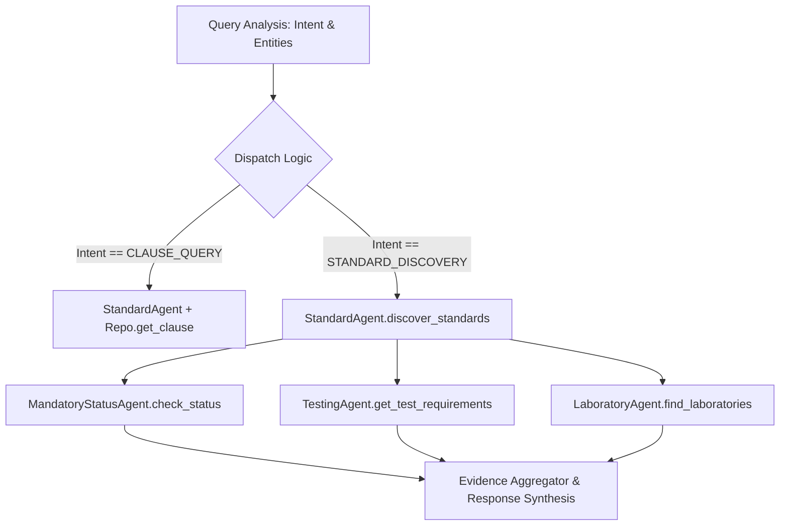

# Tool Selection & Subagent Dispatch

The `AgentOrchestrator` uses intent classification and extracted entity parameters to dynamically select and invoke domain subagents.



---

## Dispatch Decision Table

```python
# Simplified Orchestrator Dispatch Pattern
if intent == "CLAUSE_QUERY":
    return self.handle_clause_query(target_std, clause_number)

elif intent in ["STANDARD_DISCOVERY", "MANDATORY_STATUS", "TEST_REQUIREMENTS"]:
    standards = self.standard_agent.discover_standards(query, explicit_std, product_kw)
    if standards:
        target = standards[0]["standard_number"]
        qco_data = self.mandatory_agent.check_status(target)
        tests_data = self.testing_agent.get_test_requirements(target)
        labs_data = self.lab_agent.find_laboratories(target)
        return self.response_agent.generate_response(...)
```
