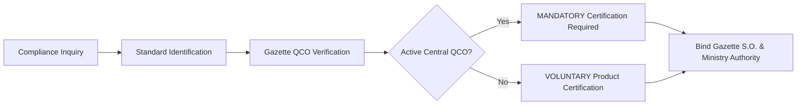

# Regulatory Compliance Engine Overview

The **Compliance Engine** ensures that every response generated by the platform adheres to the statutory provisions of the **Bureau of Indian Standards Act, 2016** and relevant ministerial Quality Control Orders.

---

## Guiding Compliance Principles

1. **Clear Separation of Existence vs Compulsion**: The system never assumes that an Indian Standard's existence implies mandatory certification.
2. **Statutory Traceability**: Mandatory claims must cite the specific S.O. number, Order Date, and Effective Date.
3. **Small Enterprise Protections**: The compliance engine explicitly highlights deferred enforcement dates for micro and small enterprises where granted by ministerial gazettes.
