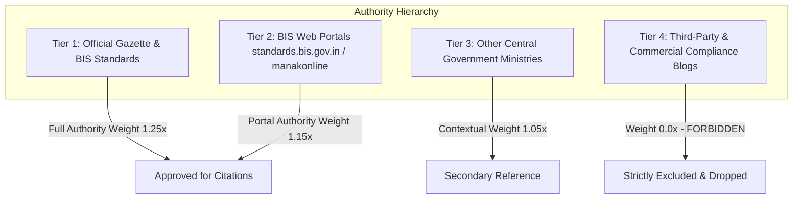

# Evidence Validation & Authority Tiers

To safeguard against misinformation, the system classifies all retrieved evidence into an immutable **Four-Tier Authority Hierarchy**.

---

## Authority Tiers & Scoring

- **Tier 1 (Official BIS & Gazette)**: Watermarked standard previews, Gazette of India S.O. notifications. Base weight: `1.25x`.
- **Tier 2 (Official BIS Portals)**: `manakonline.in`, `standards.bis.gov.in`, `crsbis.in`. Base weight: `1.15x`.
- **Tier 3 (Government Notifications)**: Line ministry policy circulars (DPIIT, Ministry of Steel). Base weight: `1.05x`.
- **Tier 4 (Unverified Third-Party)**: Wikipedia, commercial blogs, private lab marketing. **Score: 0.0 — Never accepted.**
