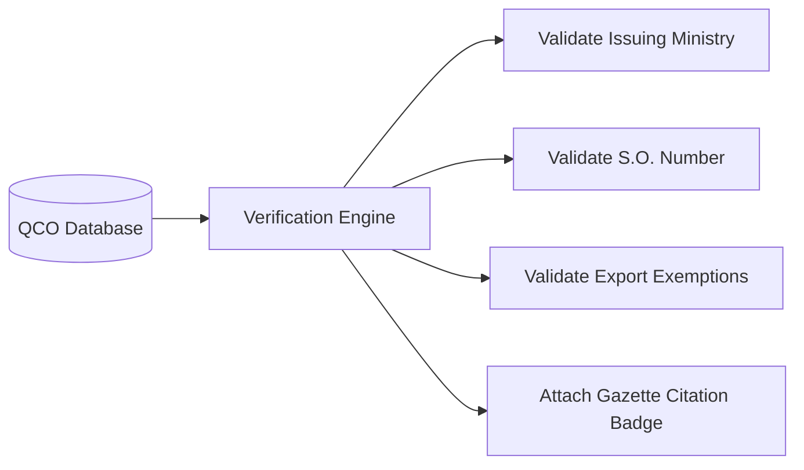

# QCO Validation & Gazette Citation

Every declaration of mandatory certification must be validated against official Gazette of India records.



---

## Statutory Gazette Data Structure

```json
{
  "standard_number": "IS 1786:2008",
  "product_name": "High Strength Deformed Steel Bars (TMT)",
  "mandatory_status": "MANDATORY",
  "qco_title": "Steel and Steel Products (Quality Control) Order",
  "issuing_ministry": "Ministry of Steel",
  "notification_number": "S.O. 4567(E)",
  "order_date": "2020-12-18",
  "effective_date": "2021-06-18",
  "exemptions": "Products manufactured exclusively for export are exempt."
}
```
