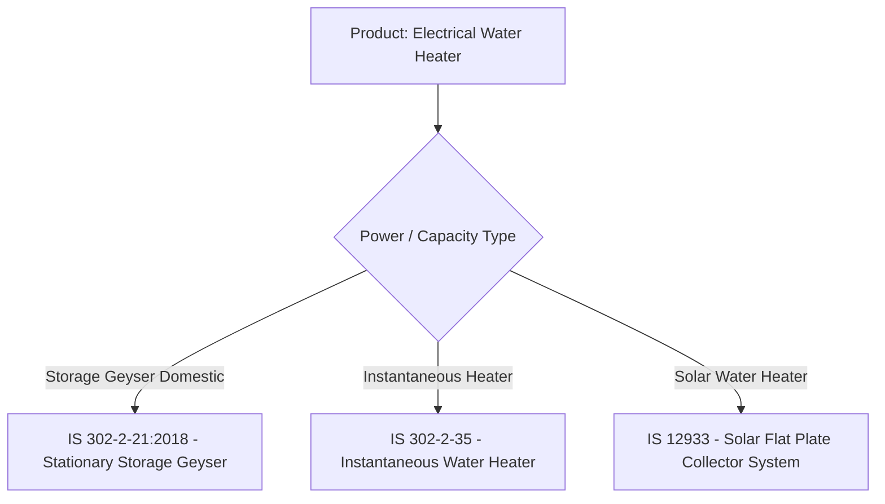

# Standard Applicability & Product Mapping

Products often cross multiple materials, voltage classes, or pressure ratings, each governed by different Indian Standards.

---

## Resolution Algorithms

The `ProductAgent` uses a priority hierarchy:
1. **Explicit IS Lookup**: Regex matches in the query take highest precedence.
2. **Product Mapping Dictionary**: Maps direct colloquial terms (`geyser`, `saria`, `marking paint`).
3. **Dynamic Catalog Expansion**: Evaluates product synonyms across `EXPANDED_STANDARDS_CATALOGUE`.
4. **Agent Clarification**: If a product has multiple distinct standards, flags disambiguation options to prompt user selection.
