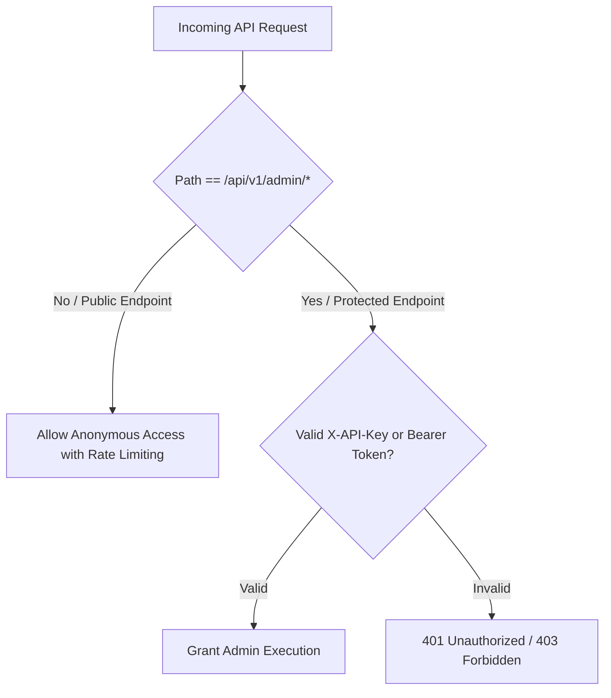

# Authentication & API Security

The API implements a flexible security model supporting both public consumer access and authenticated administrative/auditing operations.



---

## API Key Security Dependency

```python
# backend/api/auth.py
from fastapi import Security, HTTPException, status
from fastapi.security.api_key import APIKeyHeader
from backend.config.settings import settings

api_key_header = APIKeyHeader(name="X-API-Key", auto_error=False)

def verify_admin_key(api_key: str = Security(api_key_header)):
    if not api_key or api_key != settings.ADMIN_API_KEY:
        raise HTTPException(
            status_code=status.HTTP_403_FORBIDDEN,
            detail="Invalid or missing administrative API key"
        )
    return api_key
```
