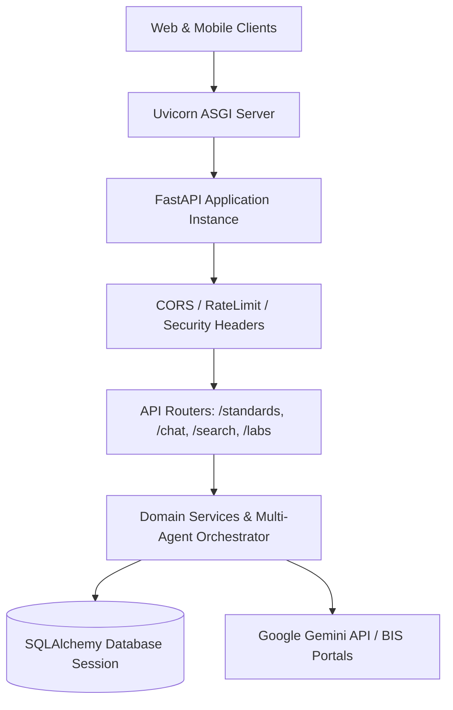

# Backend Architecture Overview

The backend is built with **FastAPI**, **Uvicorn**, and **SQLAlchemy**, providing high-throughput, asynchronous REST endpoints for search, chat, standard discovery, and compliance verification.

---

## Architectural Highlights

- **Fully Asynchronous**: Asynchronous request handlers prevent blocking during database operations or external API calls.
- **Dependency Injection**: Database sessions, configuration parameters, and subagents are injected cleanly using FastAPI's `Depends()`.
- **Automated Documentation**: Native interactive Swagger UI (`/docs`) and ReDoc (`/redoc`) generated directly from Pydantic schemas.
