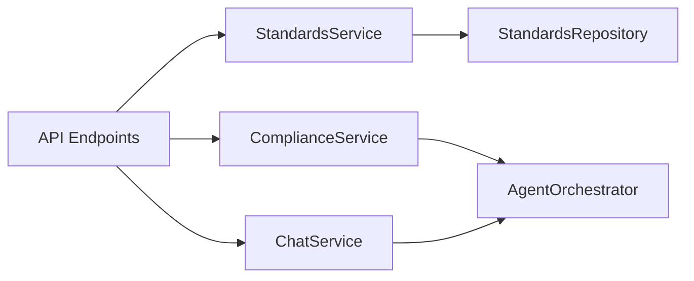

# Domain Services Layer

Domain services encapsulate business logic away from HTTP request handlers, allowing clean unit testing and reuse across CLI tools and API endpoints.



---

## Example: Standards Service

```python
# backend/services/standards_service.py
class StandardsService:
    def __init__(self, db: Session):
        self.repo = StandardsRepository(db)

    def get_standard_details(self, standard_number: str) -> Optional[Dict[str, Any]]:
        std = self.repo.get_by_is_number(standard_number)
        if not std:
            return None
        clauses = self.repo.get_clauses(std.id)
        qco = self.repo.get_qco(std.id)
        return {
            "standard_number": std.standard_number,
            "title": std.title,
            "status": std.status,
            "clauses_count": len(clauses),
            "is_mandatory": qco.mandatory_status == "MANDATORY" if qco else False
        }
```
