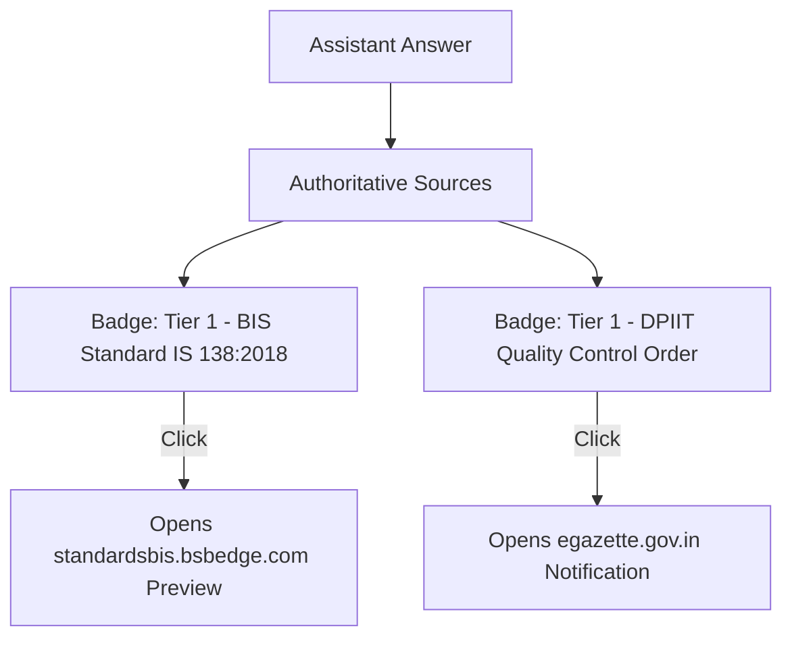

# Citations & Source Verification UI

To reinforce user trust and eliminate hallucination anxiety, every factual answer renders an interactive **Sources & Verification Drawer**.



---

## Citation Badge React Component

```tsx
// frontend/src/components/CitationBadge.tsx
export function CitationBadge({ source }: { source: Citation }) {
  const isTier1 = source.source_tier === 1;
  return (
    <a
      href={source.source_url}
      target="_blank"
      rel="noopener noreferrer"
      className={`citation-badge ${isTier1 ? 'tier-1-badge' : 'tier-2-badge'}`}
    >
      <span className="tier-tag">{isTier1 ? 'Official Tier-1' : 'BIS Portal'}</span>
      <span className="source-title">{source.source_title}</span>
      <ExternalLinkIcon />
    </a>
  );
}
```
