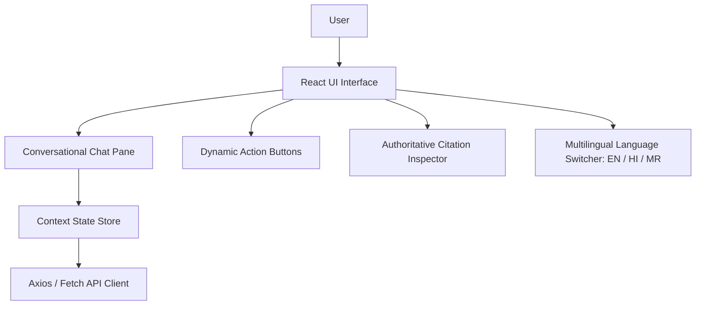

# Frontend Architecture Overview

The user interface is an accessible, high-performance web client designed to render complex regulatory specifications with clarity and transparency.

---

## Design Principles

1. **Information Scannability**: Responses are organized into clear Markdown sections (Answer, Standard Profile, QCO Requirement, Testing Clauses).
2. **Interactive Clarification**: When queries are ambiguous, action button pills allow one-click disambiguation.
3. **Transparent Authority**: Every citation badge displays its Government Source Tier (Tier-1 Official).
