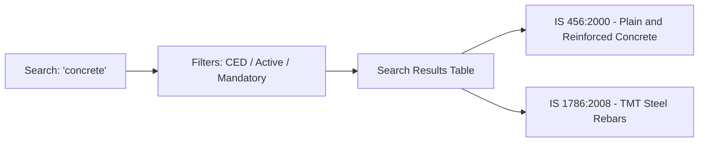

# Standards Search Interface

Alongside the conversational chat, the frontend provides an exploratory **Standards Search Directory** for browsing the Indian Standards catalog.

---

## Filtering Capabilities
- **Technical Division**: Filter by CHD (Chemical), CED (Civil), ETD (Electrical), etc.
- **Regulatory Status**: Show only products covered by mandatory Quality Control Orders (QCOs).
- **Publication Era**: Filter by recent revisions or reaffirmations.
