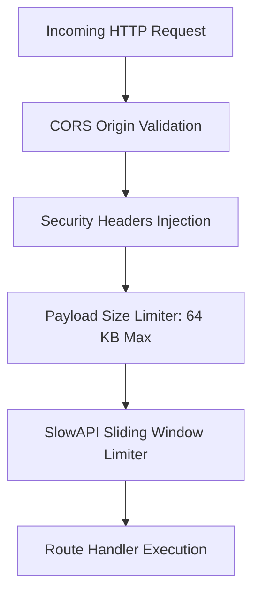

# API Security & Defense Mechanisms

The FastAPI gateway is hardened against network-level and application-level attacks.



---

## Hardened Security Headers

Every response emitted by the gateway includes modern defense headers:

```python
# Security Headers Middleware
@app.middleware("http")
async def add_security_headers(request, call_next):
    response = await call_next(request)
    response.headers["X-Content-Type-Options"] = "nosniff"
    response.headers["X-Frame-Options"] = "DENY"
    response.headers["X-XSS-Protection"] = "1; mode=block"
    response.headers["Strict-Transport-Security"] = "max-age=31536000; includeSubDomains"
    response.headers["Content-Security-Policy"] = "default-src 'self'; frame-ancestors 'none';"
    return response
```
