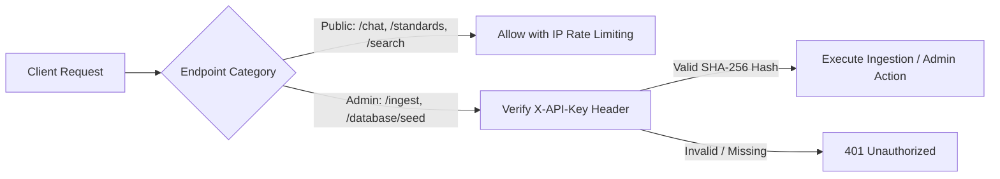

# Authentication & Identity Management

The system enforces a tiered authentication policy balancing public accessibility for MSMEs and consumers with strict credential controls for administrative ingestions.



---

## Authentication Implementation

Administrative endpoints require the `X-API-Key` header, verified using constant-time comparison to prevent timing attacks.

```python
# backend/api/auth.py
import secrets
from fastapi import Security, HTTPException, status
from fastapi.security.api_key import APIKeyHeader
from backend.config.settings import settings

api_key_header = APIKeyHeader(name="X-API-Key", auto_error=False)

def verify_admin_key(api_key: str = Security(api_key_header)) -> str:
    if not api_key:
        raise HTTPException(
            status_code=status.HTTP_401_UNAUTHORIZED,
            detail="Authentication required for administrative operations."
        )
    # Constant-time comparison to prevent timing attacks
    if not secrets.compare_digest(api_key, settings.ADMIN_API_KEY):
        raise HTTPException(
            status_code=status.HTTP_403_FORBIDDEN,
            detail="Invalid administrative credentials."
        )
    return api_key
```
