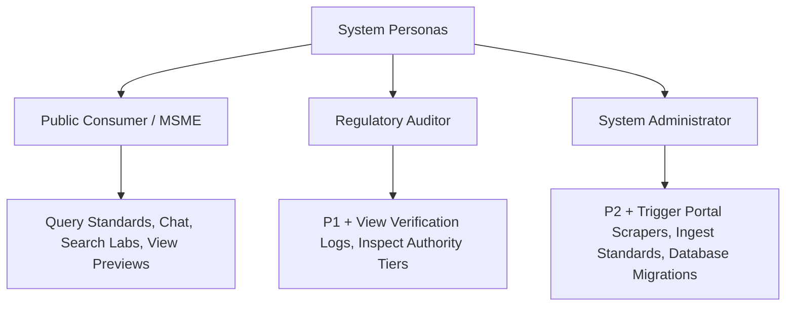

# Authorization & Role-Based Access Control (RBAC)

The system enforces strict principle-of-least-privilege across system personas.

---

## Permission Matrix

| Operation | Public User | Auditor | System Administrator |
| :--- | :---: | :---: | :---: |
| Natural Language Chat (`/chat/completions`) | Yes | Yes | Yes |
| Standards Catalog Search (`/standards`) | Yes | Yes | Yes |
| Laboratory Network Lookup (`/laboratories`) | Yes | Yes | Yes |
| Evaluation Suite Execution (`/evaluate`) | No | Yes | Yes |
| Dynamic Standard Ingestion (`/ingest/standard`) | No | No | Yes |
| Database Seed / Migration (`/database/seed`) | No | No | Yes |
