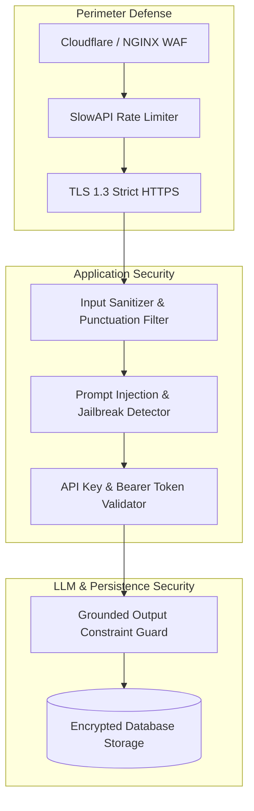

# Security Architecture & Threat Model

The BIS Intelligent Assistant operates within a Government of India regulatory context where information integrity, source verifiability, and cyber defense are paramount.

---

## Threat Model & Attack Surface

| Threat Vector | Potential Impact | Implemented Mitigation |
| :--- | :--- | :--- |
| **Prompt Injection / Jailbreak** | Manipulating assistant to bypass BIS rules or invent standards | System prompt isolation, zero-agency boundaries, strict regex validation |
| **API Denial of Service (DoS)** | Exhausting Gemini API quotas and server compute | IP-based sliding window rate limiting (SlowAPI), circuit breaker failover |
| **Data Exfiltration / Tampering** | Unauthorized modification of standards or lab scopes | Read-only portal ingestion, cryptographic checksums, DB role isolation |
| **Information Hallucination** | Misleading manufacturers into regulatory non-compliance | Four-Tier authority scoring, mandatory citation verification, safe refusal gate |
