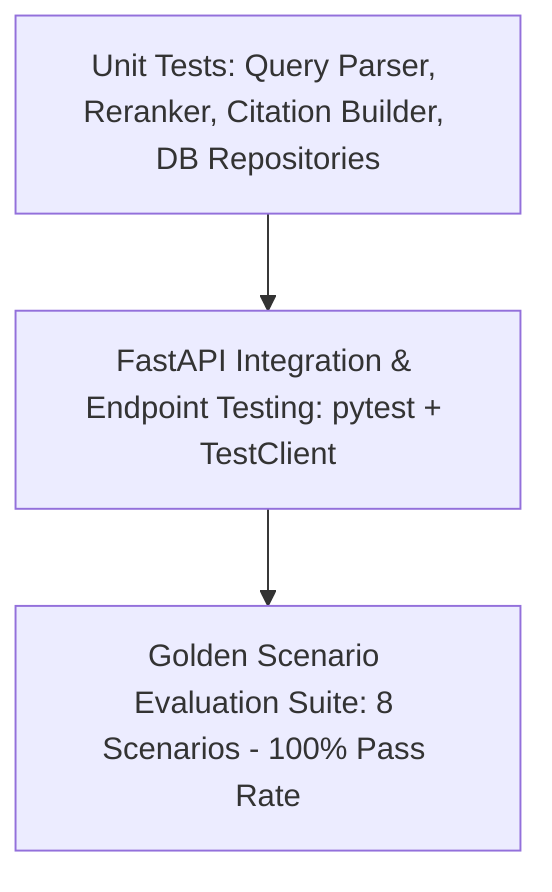

# Testing Strategy & Quality Assurance

To ensure statutory precision, the system employs a comprehensive test pyramid combining unit tests, API integration tests, and end-to-end multi-agent evaluation scenarios.

---

## Test Suites Summary

| Test Level | Scope | Tools Used | Command |
| :--- | :--- | :--- | :--- |
| **Unit Testing** | Individual parsing functions, regex extractors, reranker scoring | `pytest`, `pytest-cov` | `pytest tests/unit/` |
| **API Testing** | FastAPI route handling, status codes, Pydantic serialization | `TestClient`, `httpx` | `pytest tests/test_api.py` |
| **Agent Evaluation** | 8 Golden Regulatory Scenarios across real BIS domains | `evaluator.py` | `python -m backend.evaluation.evaluator` |
