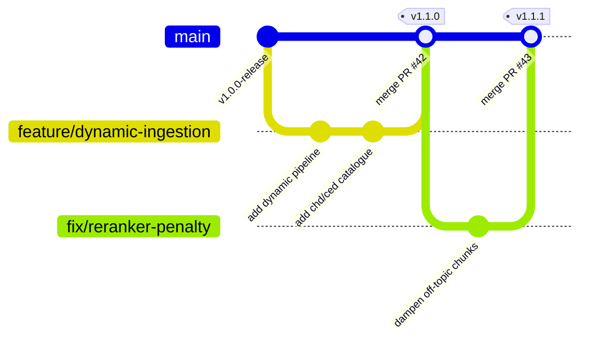

# Git Workflow & Collaboration

The project follows a **Trunk-Based / Feature Branch** workflow with mandatory pull request reviews.

---

## Conventional Commit Messages

Commit messages must follow the Conventional Commits specification:
- `feat(agents)`: Add category disambiguation follow-up buttons.
- `fix(reranker)`: Apply 50% penalty on off-topic knowledge chunks.
- `docs(api)`: Update chat completion response schemas.
- `test(eval)`: Add scenario 8 safe refusal assertion.
