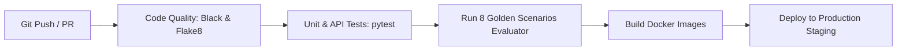

# CI/CD Automation Pipelines

Automated GitHub Actions pipelines execute on every pull request and push to the `main` branch.



---

## GitHub Actions Workflow (`.github/workflows/ci.yml`)

```yaml
name: CI/CD Pipeline

on:
  push:
    branches: [ main ]
  pull_request:
    branches: [ main ]

jobs:
  test-and-evaluate:
    runs-on: ubuntu-latest
    steps:
      - uses: actions/checkout@v4
      - name: Set up Python
        uses: actions/setup-python@v5
        with:
          python-version: '3.11'
      - name: Install Dependencies
        run: |
          cd SIH
          pip install -r requirements.txt
      - name: Run Pytest Suite
        run: |
          cd SIH
          pytest tests/ -v
      - name: Run 8 Golden Scenarios Benchmark
        run: |
          cd SIH
          python -m backend.evaluation.evaluator
```
