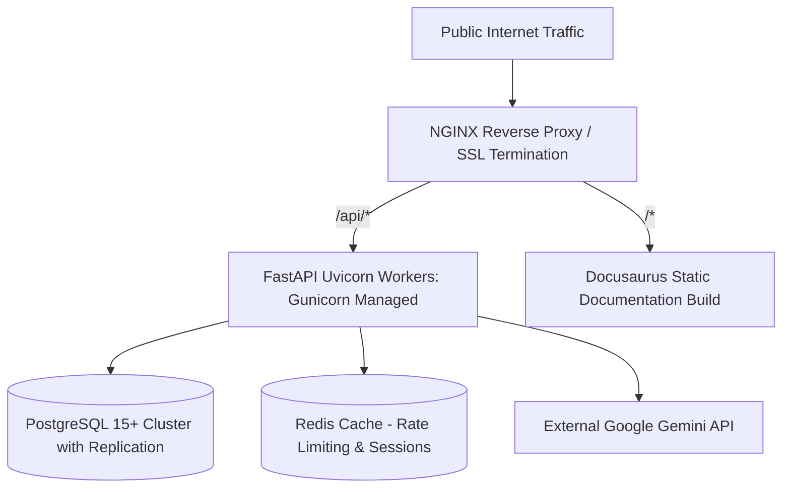

# Deployment Architecture Overview

The BIS Intelligent Assistant is deployed as a containerized, resilient microservices system capable of scaling across government cloud infrastructure (e.g., MeghRaj NIC Cloud, AWS, or Azure).

---

## Deployment Stack Components

1. **Reverse Proxy & SSL**: NGINX terminating TLS 1.3 certificates and routing traffic between the API and static documentation.
2. **API Backend**: FastAPI application managed by Gunicorn with `UvicornWorker` processes.
3. **Database Cluster**: Managed PostgreSQL instance with automated daily snapshots and pgvector enabled.
4. **Documentation Server**: Static HTML/JS build generated by Docusaurus served via NGINX or cloud CDN.
