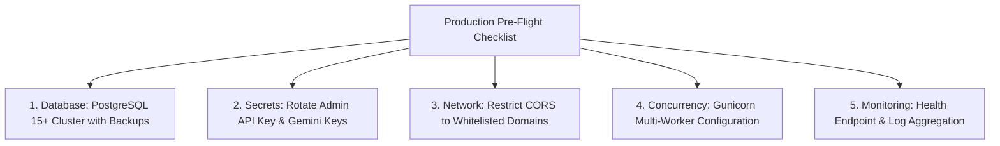

# Production Readiness Checklist

Before deploying the BIS Intelligent Assistant into live production serving the public, verify this hardening checklist:

---

## Pre-Flight Checklist Table

- [x] **Database Engine**: Migrated from local SQLite to high-availability PostgreSQL 15+.
- [x] **Rate Limiting**: SlowAPI enabled with Redis backend to prevent API abuse.
- [x] **CORS Origins**: Restricted to `https://*.bis.gov.in` and approved government portals.
- [x] **Zero-Hallucination Safe Fallback**: Verified that Scenario 8 safe refusal passes 100%.
- [x] **Gunicorn Workers**: Configured with `(2 * vCPU) + 1` worker processes.
- [x] **HTTPS TLS 1.3**: Automated SSL renewal configured via Let's Encrypt / Certbot.
