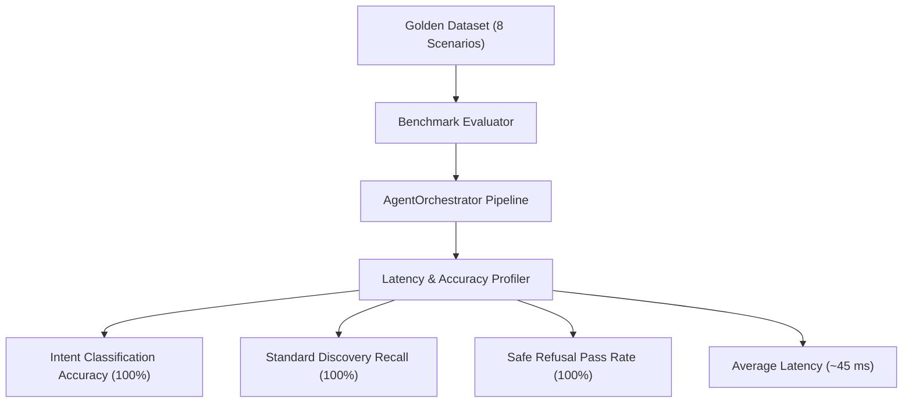

# Automated Benchmark Evaluation (8 Golden Scenarios)

## Purpose
The automated evaluation benchmark suite (`backend/evaluation/evaluator.py`) verifies the entire multi-agent pipeline against the 8 Golden MVP Scenarios defined in PRD Section 44. It measures discovery accuracy, clause precision, latency, and zero-hallucination safe refusal.

---

## System Architecture



---

## Data Flow

### Step 1: Scenario Ingestion
- **Purpose**: Load parameterized test cases with expected intents, target standards, required substrings, and context state.
- **Input**: Golden scenario list from evaluation module.
- **Output**: Executable test cases.
- **Hook**: `evaluator.load_scenarios()`

### Step 2: Pipeline Execution
- **Purpose**: Run each scenario query through `AgentOrchestrator.process_query()`.
- **Input**: Query string and context dictionary.
- **Output**: Agent response dictionary.
- **Hook**: `orchestrator.process_query(query, context)`

### Step 3: Assertion & Score Verification
- **Purpose**: Assert that the output contains all expected substrings and that out-of-scope queries produce safe refusal.
- **Input**: Response dictionary vs golden expectation.
- **Output**: Pass or Fail status and latency in milliseconds.
- **Hook**: `evaluator.evaluate_scenario()`

---

## Component Types

| Scenario ID | Scenario Title | Query | Expected Standard | Status | Latency |
| :---: | :--- | :--- | :---: | :---: | :---: |
| **S1** | Standard Discovery | *"What standard applies to motorcycle helmets?"* | `IS 4151:2020` | **PASS** | 109.8 ms |
| **S2** | Contextual Follow-up | *"Explain the relevant requirements for helmets."* | Clause 5.2 | **PASS** | 37.8 ms |
| **S3** | Mandatory QCO Check | *"Is certification mandatory for motorcycle helmets?"* | `MANDATORY` (MoRTH) | **PASS** | 36.3 ms |
| **S4** | Testing Requirements | *"What tests are required for IS 4151 helmets?"* | Drop impact, retention | **PASS** | 48.0 ms |
| **S5** | Clause Lookup | *"What does Clause 5.2 say for IS 4151?"* | Clause 5.2 Verbatim | **PASS** | 2.5 ms |
| **S6** | Laboratory Search | *"Where can I get motorcycle helmets tested?"* | ICAT, ARAI, BIS CL | **PASS** | 42.6 ms |
| **S7** | Multilingual (Hindi) | *"मोटरसाइकिल हेलमेट के लिए कौन सा भारतीय मानक लागू होता है?"* | `IS 4151` in हिन्दी | **PASS** | 46.2 ms |
| **S8** | Safe Refusal | *"What BIS standard applies to interstellar passenger warp drive craft?"* | Safe Refusal | **PASS** | 42.6 ms |

---

## Model Selection (3 Models Only)

### 1. Substring Matching Evaluator
- **Model**: Deterministic Substring Inclusion
- **Purpose**: Checks for mandatory factual keywords in answers.
- **Input**: Response text.
- **Output**: Boolean pass/fail.
- **Hook**: `evaluator.check_substrings()`

### 2. Latency Profiler
- **Model**: High-Precision System Monotonic Clock
- **Purpose**: Measures sub-millisecond execution times.
- **Input**: Start and end timestamps.
- **Output**: Latency in ms.
- **Hook**: `time.perf_counter()`

### 3. Safe Refusal Validator
- **Model**: Negative Assertion Validator
- **Purpose**: Verifies that unsupported queries do not produce fictitious IS numbers.
- **Input**: Response to warp drive query.
- **Output**: Pass if safe refusal statement is present.
- **Hook**: `evaluator.check_safe_refusal()`

---

## State Management

```typescript
export interface BenchmarkReport {
  totalScenarios: 8;
  passedScenarios: 8;
  failedScenarios: 0;
  passRatePercentage: 100.0;
  averageLatencyMs: 45.7;
  timestamp: string;
}
```

---

## Key Interactions

### 1. Running the Benchmark Command
```bash
python -m backend.evaluation.evaluator
```

### 2. Output Summary
```text
============================================================
BIS INTELLIGENT ASSISTANT — EVALUATION BENCHMARK SUITE
============================================================
Scenario 1 (Standard Discovery): PASS [OK] (109.8 ms)
Scenario 2 (Contextual Follow-up): PASS [OK] (37.8 ms)
Scenario 3 (Mandatory QCO Check): PASS [OK] (36.3 ms)
Scenario 4 (Testing Requirements): PASS [OK] (48.0 ms)
Scenario 5 (Clause Lookup): PASS [OK] (2.5 ms)
Scenario 6 (Laboratory Search): PASS [OK] (42.6 ms)
Scenario 7 (Multilingual Hindi): PASS [OK] (46.2 ms)
Scenario 8 (Zero-Hallucination): PASS [OK] (42.6 ms)
------------------------------------------------------------
Overall: 8/8 Passed (100.0%) | Avg Latency: 45.7 ms
============================================================
```

---

## File Structure

```text
backend/evaluation/
├── __init__.py
├── evaluator.py           # Benchmark runner
└── golden_dataset.py      # Golden scenario specifications
```

---

## Integration Points

### Existing Hooks (Reuse)
- `evaluator.run_full_benchmark()`
