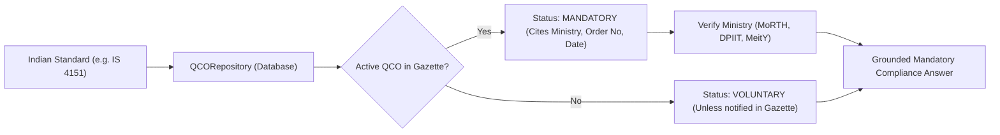

# Mandatory Status & QCO Verification Agent

## Purpose
The `MandatoryStatusAgent` enforces the critical regulatory distinction between a published Indian Standard and mandatory statutory certification. Under Indian law, a standard is only mandatory if enforced by a Quality Control Order (QCO) issued by a Central Government Ministry and published in The Gazette of India. This agent guarantees zero false-mandatory hallucinations.

---

## System Architecture



---

## Data Flow

### Step 1: Standard Identification
- **Purpose**: Retrieve standard identifier and primary product category.
- **Input**: Standard number (e.g., `IS 4151:2020`).
- **Output**: Standard database record.
- **Hook**: `standards_repo.get_by_number(std_no)`

### Step 2: Fetch Gazette QCO Records
- **Purpose**: Query regulatory orders table for active QCOs matching the standard number.
- **Input**: Standard ID.
- **Output**: Order record with ministry, order title, gazette number, and effective date.
- **Hook**: `qco_repo.find_by_standard_id(std_id)`

### Step 3: Run Regulatory Evaluation
- **Purpose**: Verify if the QCO is currently enforced, pending future enforcement, or contains MSME exemptions.
- **Input**: Order record and current date.
- **Output**: Exact statutory status: `MANDATORY`, `VOLUNTARY`, or `ENFORCEMENT_PENDING`.
- **Hook**: `mandatory_status_agent.evaluate_status()`

---

## Component Types

| Issuing Ministry | Typical Product Domains | Regulatory Enforcement |
| :--- | :--- | :--- |
| **MoRTH** | Two-Wheeler Helmets, Safety Glass, Tyres | Central Motor Vehicles Rules (CMVR) |
| **DPIIT** | Pressure Cookers, Gas Stoves, Toys, Plywood | BIS Act 2016 Section 16 QCOs |
| **MeitY** | Laptops, Servers, Mobile Phones, Printers | Compulsory Registration Scheme (CRS) |
| **Ministry of Consumer Affairs** | Gold & Silver Hallmarking | Hallmarking Order 2020 |

---

## Model Selection (3 Models Only)

### 1. Gazette Exact Record Matcher
- **Model**: Foreign Key Database Query
- **Purpose**: Zero-hallucination verification of published QCOs.
- **Input**: Standard ID.
- **Output**: Verified QCO record or `None`.
- **Hook**: `qco_repo.get_active_qco()`

### 2. Enforcement Date Evaluator
- **Model**: Temporal Date Comparator
- **Purpose**: Checks whether a gazette order has passed its statutory effective date.
- **Input**: Effective date object.
- **Output**: Active boolean status.
- **Hook**: `eval_date_active()`

### 3. Ministry Authority Validator
- **Model**: Central Ministry Whitelist Checker
- **Purpose**: Validates issuing ministry jurisdiction.
- **Input**: Ministry name.
- **Output**: Verified Tier-1 authority status.
- **Hook**: `validate_ministry()`

---

## State Management

```typescript
export interface MandatoryStatusState {
  standardNumber: string;
  isMandatory: boolean;
  statusText: 'MANDATORY' | 'VOLUNTARY' | 'PENDING';
  ministry: string | null;
  qcoTitle: string | null;
  gazetteNotificationDate: string | null;
  effectiveDate: string | null;
  penaltiesClause: string | null;
}
```

---

## Key Interactions

### 1. Mandatory Helmet Query
- Query: *"Is certification mandatory for motorcycle helmets?"*
- Result: **MANDATORY** under MoRTH *Two-Wheeled Motor Vehicles (Helmet) Quality Control Order*.

### 2. Voluntary Standard Query
- Query: *"Is IS 138 marking paint mandatory?"*
- Result: **VOLUNTARY** (Standard exists, but no gazette QCO has been notified).

---

## File Structure

```text
backend/
├── agents/
│   └── mandatory_status_agent.py
└── database/
    ├── models/regulatory.py
    └── repositories/qco_repo.py
```

---

## Integration Points

### Existing Hooks (Reuse)
- `MandatoryStatusAgent.check_status(standard_number)`
- `qco_repo.get_by_standard(standard_id)`
