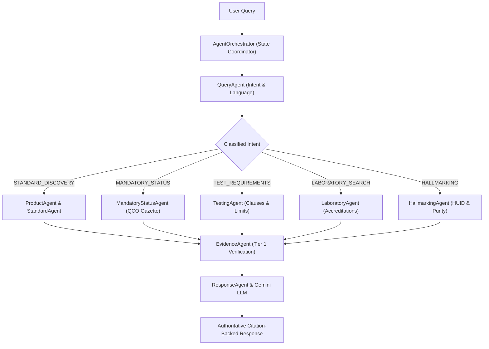

# Multi-Agent Architecture & Orchestrator

## Purpose
The **BIS Intelligent Assistant** utilizes a decoupled multi-agent topology orchestrated by `AgentOrchestrator`. Rather than relying on a single generalist LLM prompt, specialized agents divide responsibilities across intent classification, standard discovery, gazette legal verification, laboratory search, and citation synthesis.

---

## System Architecture



---

## Data Flow

### Step 1: Query Analysis & Greeting Detection
- **Purpose**: Identify conversational greetings (`"hi"`, `"namaste"`), detect explicit standard numbers (`IS 4151`), and classify intent.
- **Input**: Query string and conversation session context.
- **Output**: Analysis dictionary with `intent`, `standard_number`, `language`.
- **Hook**: `query_agent.analyze(query, context)`

### Step 2: Context Resolution & Subagent Dispatch
- **Purpose**: Maintain dialog memory (e.g. pronoun `"it"` refers to `IS 4151` from previous turn). Dispatch the appropriate specialized agent.
- **Input**: Current query and context from memory.
- **Output**: Agent execution result payload.
- **Hook**: `AgentOrchestrator.process_query()`

### Step 3: Evidence Gate & Confidence Computation
- **Purpose**: Verify that factual claims are backed by Tier-1 database records. Compute confidence: `HIGH`, `MEDIUM`, or trigger safe refusal if evidence is lacking.
- **Input**: Aggregated subagent outputs.
- **Output**: Verified answer payload.
- **Hook**: `evidence_agent.validate()`

---

## Component Types

| Agent Name | Source File | Core Responsibility |
| :--- | :--- | :--- |
| **`AgentOrchestrator`** | `backend/agents/orchestrator.py` | State machine, conversational memory, routing |
| **`QueryAgent`** | `backend/agents/query_agent.py` | Intent classification, language detection |
| **`ProductAgent`** | `backend/agents/product_agent.py` | Product normalization, category disambiguation |
| **`StandardAgent`** | `backend/agents/standard_agent.py` | Standard catalog discovery, hybrid retrieval |
| **`MandatoryStatusAgent`** | `backend/agents/mandatory_status_agent.py` | Gazette Quality Control Order (QCO) verification |
| **`TestingAgent`** | `backend/agents/testing_agent.py` | Testing schedules, acceptance thresholds |
| **`LaboratoryAgent`** | `backend/agents/laboratory_agent.py` | BIS Central and Regional lab discovery |
| **`EvidenceAgent`** | `backend/agents/evidence_agent.py` | Zero-hallucination statutory verification |
| **`ResponseAgent`** | `backend/agents/response_agent.py` | Multilingual response synthesis & citations |

---

## Model Selection (3 Models Only)

### 1. Gemini Conversational Reasoning Model
- **Model**: `gemini-1.5-flash` / `gemini-2.0-flash`
- **Purpose**: Formulates natural, fluent explanations grounded strictly on retrieved context.
- **Input**: Grounded system prompt and database citations.
- **Output**: Markdown response text.
- **Hook**: `LLMEngine.generate_grounded_response()`

### 2. Rule-Based Intent Classifier
- **Model**: Deterministic Regular Expression + Keyword Classifier
- **Purpose**: Sub-millisecond intent routing without LLM token latency.
- **Input**: Query string.
- **Output**: One of 16 BIS Action Intents.
- **Hook**: `query_agent.classify_intent()`

### 3. Disambiguation Decision Tree
- **Model**: Multi-Category Product Disambiguation Matrix
- **Purpose**: Identifies ambiguous broad product queries (e.g. `"paint"`, `"helmet"`, `"cooker"`) and prompts for clarification.
- **Input**: Extracted product entity.
- **Output**: Interactive clarification question and suggested options.
- **Hook**: `product_agent.disambiguate()`

---

## State Management

```typescript
export interface MultiAgentContext {
  conversationId: string;
  lastStandard: string | null;
  lastProduct: string | null;
  lastIntent: string | null;
  language: 'en' | 'hi' | 'mr';
  requiresClarification: boolean;
  clarificationOptions: Array<{
    label: string;
    standard: string;
    mandatory: boolean;
  }>;
}
```

---

## Key Interactions

### 1. Multi-Turn Context Carryover
- Turn 1: *"What standard applies to motorcycle helmets?"* - Resolves `IS 4151:2020`.
- Turn 2: *"What tests are required for it?"* - Resolves `"it"` to `IS 4151` and triggers `TestingAgent`.

### 2. Disambiguation Prompt
- Query: *"I make paints"* - System prompts: *"Which type of paint do you produce: Marking paint (IS 138) or Synthetic enamel (IS 2932)?"*

---

## File Structure

```text
backend/agents/
├── orchestrator.py
├── query_agent.py
├── product_agent.py
├── standard_agent.py
├── mandatory_status_agent.py
├── certification_agent.py
├── testing_agent.py
├── laboratory_agent.py
├── hallmarking_agent.py
├── evidence_agent.py
└── response_agent.py
```

---

## Integration Points

### Existing Hooks (Reuse)
- `orchestrator.process_query(query, context, api_key)`
- `query_agent.analyze(query, context)`
